

  ⚠️
  

    
Synthetic bank notice

    
No Gut Feelings Bank does not exist. Its deposit franchise is the posterior-predictive draw the earlier posts used, and its asset mix is a draw from the population of the six largest South African banks, with every bank-specific effect integrated out. Real banks appear only pooled into peer groups of at least four. Nothing here ranks, names, or reverse-engineers any individual institution. Nothing here is financial advice.

  

{{< summary   trader="The deposit series ended with NGFB's funding understood and its run priced. This post gives the bank the rest of a balance sheet and asks what an ALCO asks of every macro pack: how exposed are we, what does each scenario do to our returns, and what should we do before it arrives? Public SARB data carry the economy to the industry and the industry to the bank, and the answers are less flattering to forecasting than ALCO packs usually are. NGFB's structural hedge turns out to be a rate bet sized for slower deposits than it has. Positioning ahead of a stagflationary downside recovers 21 bps of a 253 bp hit, and costs 48 bps if the upside turns up instead. Replay sixty-one three-year windows of South African history from today's balance sheet and timing the rate cycle earns nothing on average. What does pay is collecting premia that need no view at all: the fiscal premium in government bonds swapped to floating, and the gap between wholesale funding and Treasury bills in a smaller liquidity buffer. Chosen together with the hedge, the bond book and the payout, under limits on earnings, capital, liquidity and interest-rate risk, the levers lift NGFB's average ROE from 12.8% to 15.0% and beat the plan in every one of the histories. One lever the optimiser did not have, asset-swapped bonds funded in repo outside the buffer, adds another 20 bps. It also shows why a risk budget with no credit-spread limit is not finished."   loremaster="Two-stage top-down design on the identity g_bank = g_sector + Δlog s. Stage 1: sign-restricted ARDL industry models (details withheld) map macro paths to 22 BA900/BA120 sector series under perfect foresight. Stage 2: 400Δlog s on contraction/hiking/easing dummies and the sector cycle by peer group (k ≥ 4), pooled with DerSimonian–Laird random effects; NGFB's parameters are a truncated posterior-predictive draw, drift off. Quarterly engine: line-level NII on sector yields and costs, a laddered receive-fixed hedge at actual ZAR swap fixings (3m JIBAR, then compounded ZARONIA + 16.19 bp CAS from 2027Q1), sector credit-loss ratio with relative multipliers, CET1 with the FVOCI reserve, LCR/NSFR proxies calibrated to PA aggregates. Positioning: Black–Litterman-style reverse optimisation (implied cost c = G_baseline), quadratic execution costs, closed form x* = (G − c)/2κ, net gain scaling as 2α − α². Strategy lab: historical simulation over 61 overlapping 12-quarter windows since 2008 from the 2026Q2 jump-off, seven pre-set macro-keyed rules. Risk-budgeted optimiser: exhaustive scoring of 25,200 lever combinations through an additive surrogate with payout roll-forward (max error 0.03 bp against the exact engine), subject to the 5th-percentile ROE, CET1 at fair value, LCR at market value, NSFR, |ΔEVE(±200bp)| against the plan within 5% of CET1, and a 90% liquidity-book cap. Optimum: 37% hedge reinvested at 7y, 12.5% of earning HQLA in 10y SAGBs, 50% in asset-swapped 5y SAGBs, LCR 160%, state-contingent payout: +213 bps, p5 +198 bps, 61/61 wins; EVE and the cap bind. Repo-funded ASW carry (bs + f − repo − 10 bp ≈ 0.58 pp) consumes leverage and CSRBB rather than HQLA or EVE; the stagflationary downside's CET1 floor caps it at R50bn (+20 bps), about 11 bps of ROE per point of CET1 of spread budget.">}}

The deposit series ([one](./posts/deposit-beta-1-4/), [two](./posts/deposit-duration-2-4/), [three](./posts/hedge-optim-3-4/), [four](./posts/pricing-unknown-4-4/)) ended with No Gut Feelings Bank's funding understood about as well as public data allow. Balances that do not run off. Betas that separate cleanly by product. A structural hedge whose size follows from those betas rather than from an argument. And a run that cannot be estimated from the returns, so it was priced instead. All four posts were about one side of the balance sheet, and all four took the economy as given.

An ALCO gets to do neither. Every quarter the macro pack arrives (the house view, an upside, a downside, sometimes a scenario the regulator has asked for) and the committee asks the same three questions of it. How exposed are we? What does each scenario do to our returns? What should we do before it arrives? There is a fourth question that rarely makes the pack, because it is uncomfortable: what should we do when we do not know which scenario is coming? Which is always.

Most banks own the machinery to answer them, and point it at something else. Macro models in a bank usually live with the stress-testing team: they turn the regulator's adverse scenario into a capital ratio for the internal capital adequacy assessment (ICAAP) and supply the forward-looking scenarios behind the IFRS 9 credit provisions. Once a year they prove that the bank survives something unpleasant, and then they go back in the cabinet with the good crockery. That undersells them. A model that can say what a recession does to capital can say what any macro path does to every line of the balance sheet, which makes it useful every quarter, for three jobs a stress test never asks of it:

-   **Strategy.** Which balance-sheet decisions (the hedge, the liquidity book, the bond portfolio, the payout) depend on a macro view and which do not, and what each is worth either way.
-   **Performance against the market.** A business that grew its book 8% while its market grew 12% lost ground, however well 8% presents at bonus time. Take the market's growth out of each segment's and what is left is what management actually did.
-   **What is reasonable to expect.** What the card book, the home loans or the deposit franchise can deliver in each scenario, given its market and how a typical bank behaves in that phase of the cycle. A target becomes arithmetic rather than a negotiation, and the ALCO knows in advance which segments will look bad next year for reasons that are not their fault.

This post puts the machinery to all three jobs for NGFB, with public SARB data and nothing else, and answers the four questions on the way. It gives the bank the rest of its balance sheet, ties the economy to the industry and the industry to the bank, and runs the result through three scenarios and then through 61 replayed windows of South African history since 2008. The answers are less flattering to forecasting than ALCO packs usually are. NGFB's hedge turns out to be a rate bet. Positioning ahead of a downside recovers a sliver of the damage and costs more than it earns if you are wrong. Across sixty-odd histories, timing the rate cycle earns nothing on average. What pays is collecting premia that need no view at all, and choosing every lever together under an explicit risk budget lifts NGFB's average ROE from 12.8% to 15.0%, beating its plan in every one of the histories. Then there is one more lever, which the optimiser did not have until I went looking for it.

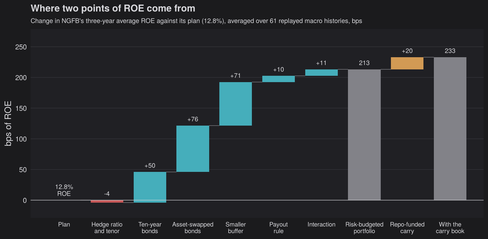

Most of that comes from two trades that would look dull in a board pack, and the dullness is the point. Neither depends on where the repo rate goes. The rest of this post builds up to that result one piece at a time, because every piece turned out to matter, including the ones that went wrong.

## From the macro to one bank, in two stages

The obvious way to tie a bank to the economy is to regress the bank's numbers on macro variables. It is also a reliable way to produce nonsense. A single bank's history is short, and it is full of things that are not the economy: an acquisition, a new strategy, a provisioning overlay, a curatorship. Regress that on GDP and you get elasticities that are unstable and, more often than is comfortable, the wrong sign. It is like judging a flyhalf's form by the rand--dollar exchange rate. There will be a correlation, and you will regret acting on it.

So the macro relationships are estimated once, on the industry, where the economy is the main thing moving the numbers, and the bank is modelled relative to the industry. For any product $p$, the identity

$$g^{\text{bank}}_{p,t} \;=\; g^{\text{sector}}_{p,t} \;+\; \Delta \log s_{p,t}$$

splits the bank's growth in quarter $t$ into two pieces. Growth $g$ is measured in logs so that the pieces add rather than multiply, and $s_{p,t}$ is the bank's market share of product $p$. The first piece is how fast the whole market grew. The second is how much faster or slower than the market the bank grew, which is exactly the change in its market share. Being an identity, it cannot be wrong. What it does is split one hard problem into two tractable ones. How the industry responds to the economy is where the macro lives. Whether this bank gains or loses ground, and when, is where the bank lives.

**Stage 1** maps a macro path to the industry: the growth of each loan and deposit book, lending spreads over prime and the three-month benchmark, deposit costs, the credit-loss ratio, fees and operating costs. That is 22 series in all, built on the SARB's BA900 and BA100/BA120 returns (South African Reserve Bank 2025). The workhorse is a sign-restricted ARDL model, and that is all I am going to say about it here. Its specification, its estimates and how it was chosen are staying in the drawer for now, like any koeksister recipe worth having. For this post it is a black box with a simple contract: hand it a macro path, and it hands back the industry's volumes, margins and losses along that path.

One design choice matters for everything that follows. **Nothing in this post forecasts the economy.** Every macro path, whether a scenario or a slice of history, is taken as given, and the only question is what it does to the bank. That is deliberate. An ALCO will argue about which scenario is coming whatever any model says. The model's job is to make sure everyone is arguing about the same consequences.

**Stage 2** is the bank's part, and it is simple enough to write down in full. For each peer group and product, the annualised change in log market share is

$$400\,\Delta \log s_t \;=\; a \;+\; \delta_{\text{c}}\,C_t \;+\; \delta_{\text{h}}\,H_t \;+\; \delta_{\text{e}}\,E_t \;+\; \kappa\,\big(g^{\text{sector}}_t - \bar g\big) \;+\; e_t .$$

Read it left to right. The 400 turns a quarterly change in log share into percentage points a year: four quarters, times a hundred. $a$ is the structural drift, how fast the group gains or loses share in an ordinary quarter, which for some groups is a decade-long march summarised in one number. $C_t$, $H_t$ and $E_t$ are switches that turn on in contraction, hiking and easing quarters, so each $\delta$ is the extra drift in that regime compared with a neutral quarter. The $\kappa$ term asks whether the group grows faster than the market when the market is booming, meaning sector growth $g^{\text{sector}}_t$ above its average $\bar g$, and slower when it is not. $\kappa > 0$ is a pro-cyclical share. $e_t$ is everything else: a new app, a new chief executive, a weekend the core banking system spent offline.

The regimes are defined mechanically, with contraction taking priority. A quarter is a contraction if real GDP is lower than a year earlier. Otherwise it is hiking or easing if the repo rate has moved up or down by at least 25 bps over two quarters, and otherwise it is neutral. Since 2008 that gives 11 contraction quarters, 18 hiking, 17 easing and 28 neutral.

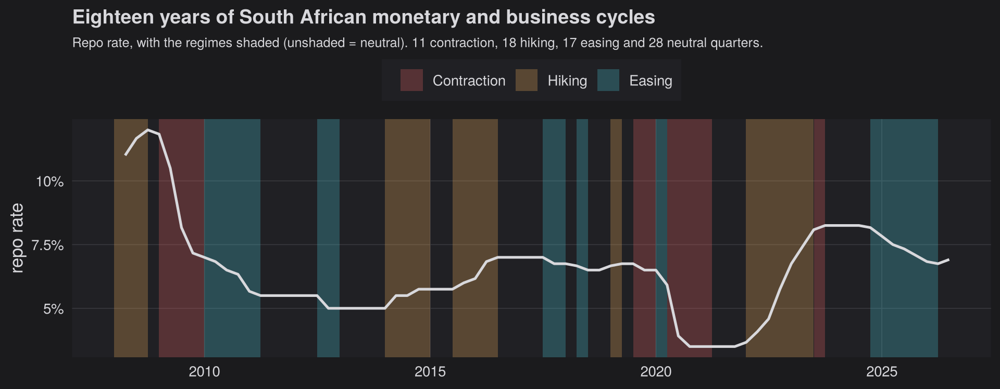

Real banks only ever appear pooled, in peer groups with at least four members in every quarter. The Big Four are the universal banks that have dominated South African banking for decades. The Challengers are the retail and digital banks that have taken share since 2008. The Specialists are business, private-client, Islamic and community banks, and everyone else is Other.

The bank layer needs more than peer-group averages, though, because NGFB has to be a plausible *single* bank. So the six large banks' equations are estimated one by one and pooled into a population with a random-effects estimator (DerSimonian and Laird 1986). Each bank's estimate $\hat\theta_b$ of a parameter is treated as the population mean, plus the bank's genuine difference from it, plus estimation noise:

$$\hat\theta_b \;=\; \mu \;+\; u_b \;+\; \varepsilon_b, \qquad u_b \sim N(0,\tau^2), \qquad \varepsilon_b \sim N(0,\mathrm{se}_b^2).$$

The noise variances are known, because every estimate comes with its standard error. So whatever spread between the banks' estimates is left over beyond what noise can explain is genuine difference between banks, $\tau^2$. DerSimonian and Laird estimate it by the method of moments, and the population mean $\mu$ is then a weighted average that trusts the precisely estimated banks more than the noisy ones. NGFB's parameters are a draw for a new member of that population, from $N(\mu,\,\tau^2 + \mathrm{se}_\mu^2)$: the population mean, spread by both the genuine differences between banks and the uncertainty about the mean itself. The draw is truncated to the same central probability mass the deposit posts used, which keeps NGFB typical. NGFB's own structural drift is then switched off. A drawn drift of a few percent a year compounds into large and arbitrary share gains over three years, and the question here is how NGFB responds to the cycle, not whether it can out-grow the market by decree.

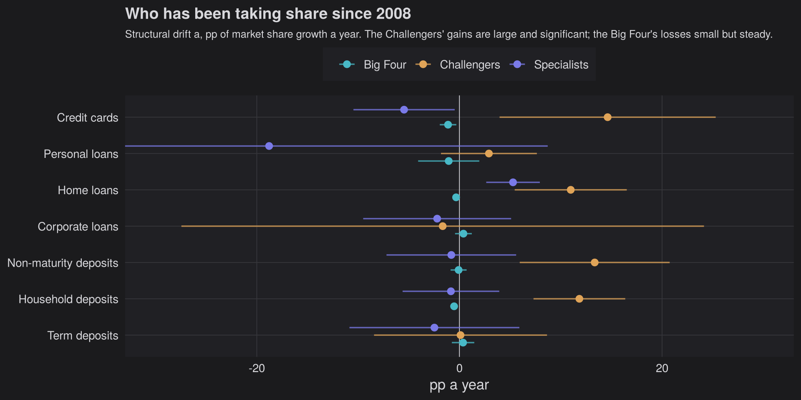

The drifts carry the clearest message in the share data. Over 2008--2026 the Challengers took share at double-digit rates in credit cards (+14.6 pp a year, $t$ = 2.7), household deposits (+11.8, $t$ = 5.2) and non-maturity deposits (+13.4, $t$ = 3.6). The Big Four ceded share slowly but steadily in cards, household deposits and home loans. The regime effects are mostly imprecise, which is what eleven contraction quarters buy you: plenty of misery, not much precision. It is why they are pooled across banks and truncated before they reach NGFB rather than trusted bank by bank.

## NGFB gets the rest of a balance sheet

The deposit posts only needed NGFB's deposits. This one needs everything, so NGFB inherits what the series fixed and gets the rest by the same rule: a typical large South African bank, drawn from the population, never a copy of any one of them.

What carries over is the deposit franchise. The mix of operational, notice, savings and term deposits (41.7%, 10.8%, 7.5% and 39.9%), the product-level betas, the structural hedge at 49.6% of non-maturity deposits received fixed in a five-year rolling ladder, and Post 3's bridge from interest-earning assets to equity.

What is new is everything else. NGFB's size is the average of the six largest banks: R1,431bn of assets, 15.5% of the BA900 sector at 2026Q2. Its asset mix is drawn from the population of the same six banks, and that draw needs one piece of machinery worth explaining, because balance-sheet shares are awkward objects. They are positive and they add up to one, so you cannot put a normal distribution on them directly: a normal draw would happily produce negative mortgages. The standard fix is the additive log-ratio transform (Aitchison 1986). Divide every share by a reference share and take logs,

$$z_k \;=\; \log\frac{w_k}{w_K}, \qquad k = 1,\dots,K-1,$$

which turns $K$ shares that must add to one into $K-1$ unconstrained numbers. Fit a multivariate normal to the six banks' $z$'s, draw from it, and transform back. Every draw is then a valid balance sheet. Six banks cannot pin down the covariance of eleven product shares, which would be 66 parameters from six observations, so the draw is made over six business lines (five dimensions) and products are split within each line at the population's average mix.

The draw is truncated by its Mahalanobis distance from the population centre,

$$d \;=\; \sqrt{(z-\mu)^{\top}\,\Sigma^{-1}\,(z-\mu)} \;\le\; r ,$$

which measures how far a draw sits from the centre in units that allow for the spread and correlation of the population: in one dimension, $d = 1$ is one standard deviation. The radius $r$ = 1.53 keeps the same central probability mass in five dimensions as the deposit draw's radius of 1 did in three. NGFB lands at $d$ = 0.95, comfortably inside.

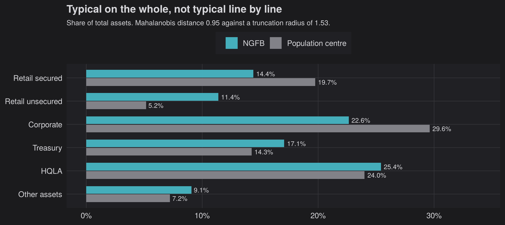

Typical on the whole is not typical line by line. The seed puts NGFB on the unsecured side of the population, with retail unsecured lending at 11.4% of assets against the centre's 5.2%. That is a legitimate member of the population, since one of the six large banks is an unsecured specialist, and it is kept because the seed is canonical. Rerolling a seed until you like the bank is how audit findings are born. It colours everything that follows. NGFB holds 26% of the industry's credit cards and 23% of its personal loans, against 9% of home loans, and its credit-loss ratio sits well above the sector's.

NGFB is *added* to the industry rather than carved out of it, the convention the deposit posts used. Real banks keep their own books, market shares are measured against the sector plus NGFB, and NGFB's history is back-cast with its drawn share parameters, so that it lives through 2008--2026 the way a bank with those parameters would have.

Prices, losses and costs exist only at sector level, because BA900 is the only return published per bank. So NGFB is priced with the sector's own yields, deposit costs, loss ratio and cost ratios, and the parameters nobody publishes are solved for rather than assumed. The wholesale funding spread, 1.17 pp over the three-month benchmark, is the one that makes the engine's net interest income on the sector's balance sheet match what BA120 reports for the last four quarters. The liquidity run-off scalars are the ones that reproduce the sector LCR of 149.6% and NSFR of 117.3% that the Prudential Authority publishes (Prudential Authority 2025b). NGFB starts with a CET1 ratio of 13.1%, an LCR of 190% and an NSFR of 132%: more liquid than the sector, because it holds more HQLA and less wholesale funding.

## The engine

Each quarter the engine does what a bank's planning model does, line by line. Every book grows with the industry's growth for that product, adjusted by NGFB's share dynamics, and wholesale funding balances the books, which is what a bank actually does at the margin. Then comes the income statement, starting with net interest income:

$$\text{NII}_t \;=\; \sum_{i\,\in\,\text{assets}} \bar B_{i,t}\,\frac{y_{i,t}}{4} \;-\; \sum_{j\,\in\,\text{liabilities}} \bar B_{j,t}\,\frac{c_{j,t}}{4} \;+\; H_t .$$

That is average balance $\bar B$ times rate, a quarter at a time, for every asset (at yield $y$) and every liability (at cost $c$), plus $H_t$, the structural hedge's net settlement. Loans earn prime or the three-month benchmark plus the industry's projected spreads, deposits cost the industry's projected deposit costs, and HQLA earns roughly the Treasury bill rate. The hedge term deserves its own line, because it is where most of this post's money is made and lost:

$$H_t \;=\; \sum_{i} N_i\,\frac{F_i - f_t}{4} .$$

Each tranche $i$ of the receive-fixed hedge earns its fixed rate $F_i$ and pays the floating benchmark $f_t$ on its notional $N_i$. One twentieth of the book matures every quarter and is replaced at the then five-year swap rate, so the book's average fixed rate drifts slowly while the floating rate moves at the speed of the Monetary Policy Committee. The gap between the two is the hedge carry, and it is the whole story of how a structural hedge makes or loses money.

Below NII the engine is plain accounting, the part nobody presents at conferences and every number depends on:

$$\text{NI}_t \;=\; (1-\tau)\big(\text{NII}_t + \text{NIR}_t - \text{Opex}_t - \text{Imp}_t\big), \qquad \text{ROE}_t \;=\; \frac{4\,\text{NI}_t}{\tfrac12\,(E_{t-1}+E_t)} .$$

Fees ($\text{NIR}$) and operating costs follow the industry's ratios to assets. Impairments are the industry's credit-loss ratio scaled up or down by product, unsecured highest and home loans lowest, because no return publishes losses by product. Net income is profit after tax at rate $\tau$. Half of it is paid out and the rest retained, so equity rolls forward as $E_t = E_{t-1} + \text{NI}_t - \text{dividends}_t$, and ROE is annualised net income over average equity. The CET1 ratio is CET1 over risk-weighted assets, and the LCR and NSFR are proxies built from BA900's depositor-by-maturity matrix. Every ROE in this post is the average over the twelve quarters from 2026Q3 to 2029Q2.

One more piece of plumbing has become topical. JIBAR, the three-month rate that floating loans, wholesale funding and the hedge's floating leg have referenced for a generation, publishes its last fixing on 31 December 2026 (South African Reserve Bank, Market Practitioners Group 2025), so somebody in every treasury already knows how they are spending New Year's Eve. From 2027Q1 the engine's floating benchmark is compounded ZARONIA plus the fixed 16.19 bp fallback spread, so ten of the twelve projected quarters are priced off JIBAR's successor. More on what that does further down.

## Three scenarios, and who wins in each

| Scenario | What happens | Probability |
|------------------------|------------------------|------------------------|
| **Baseline** | Inflation peaks above 5% around the turn of the year and is back at the 3% target by late 2027. The repo rate holds at 7.25%, then eases gradually to a neutral 6.25%. Growth settles at about 1.6%. | 50% |
| **Upside:** faster disinflation and a growth dividend | Oil and food prices ease and inflation reaches the target early. The SARB cuts a further 100 bps, terms-of-trade gains and electricity and logistics reform lift growth to about 3%, the rand firms and the long bond rallies about 100 bps. | 20% |
| **Downside:** stagflationary shock | A fiscal slippage and a rand sell-off push inflation above 6%. The SARB hikes a further 150 bps and the long bond sells off about 200 bps. The economy contracts for two years, unemployment rises 2.5 points and house prices fall. | 30% |
| **Downside with cuts** (variant) | The same contraction, but inflation falls and the SARB cuts 150 bps instead of hiking. | -- |

The baseline starts from the realised data at 2026Q2 and follows the SARB's own guidance for the year ahead: the repo rate at 7.25% after the September 2026 increase, inflation above 5% around the turn of the year and back at the 3% target (adopted, with a one-point tolerance band, in November 2025) by late 2027. The upside and the downside are shocks layered on top, with build-up, hold and decay profiles, and everything derived from them (prime, the floating benchmark, the curve's slope, swap rates) is recomputed so that every path hangs together.

The downside is deliberately stagflationary. The SARB built the domestic adverse scenario of its 2023 common stress test the same way: a higher country risk premium and a sharply weaker rand push inflation up, the SARB tightens, bond yields reprice and the economy contracts (South African Reserve Bank 2023b). The other kind of recession, demand-led, with inflation falling and the SARB cutting as in 2009 and 2020, is run as a variant with the same real shock. For a hedged bank, as the numbers below show, the policy response decides the sign of the rate effect.

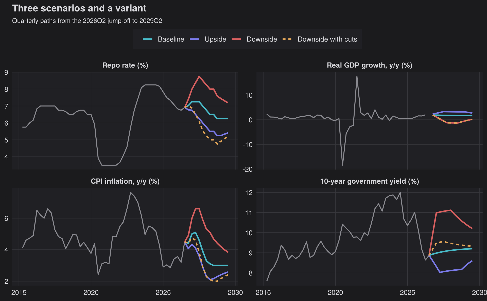

Here is what the engine makes of them, as three-year averages.

| Scenario | NGFB ROE | against the baseline | Net income, 3 years | NGFB without its hedge | Sector ROE | CET1 trough |
|-----------|-----------|-----------|-----------|-----------|-----------|-----------|
| Baseline | 13.2% | -- | R46.3bn | 11.8% | 15.7% | 12.6% |
| Upside | 14.8% | +157 bps | R52.4bn | 12.1% | 15.6% | 12.7% |
| Downside | 10.7% | -253 bps | R36.7bn | 11.1% | 15.9% | 12.4% |
| Downside with cuts | 11.8% | -144 bps | R40.8bn | 8.5% | 12.8% | 12.7% |

To see where each difference comes from, the engine swaps one block of inputs at a time from the baseline into the scenario: volumes (the growth paths), pricing (rates, yields and deposit costs, and with them the hedge), credit (the loss ratio), and fees and costs. Whatever remains when all four are swapped together is the interaction, so the bars always add up to the total. The sector is run through the same engine, unhedged.

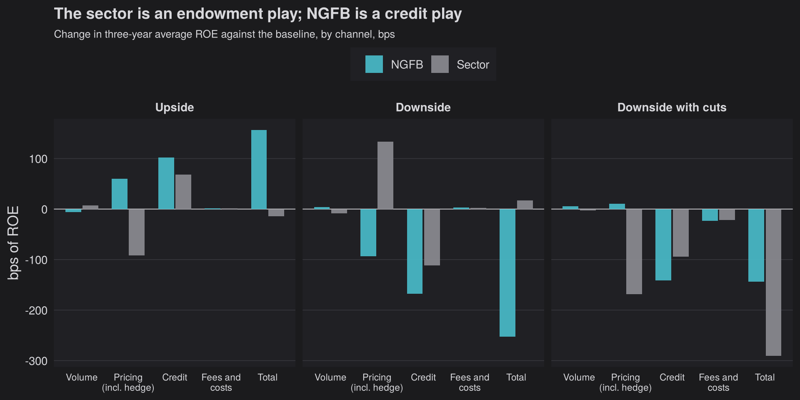

**The industry is an endowment play.** Deposits and equity are cheap funding that a bank lends out at market rates, so when rates rise, it earns more on them (Drechsler, Savov, and Schnabl 2021). Without a hedge, the higher repo path in the downside adds +133 bps to the sector's ROE through pricing and more than offsets its credit losses (-111 bps). In the upside, the cuts take 92 bps away and better credit only partly compensates.

**NGFB is a credit play.** Its unsecured-heavy book makes credit its largest channel (-168 bps in the downside, +102 bps in the upside). And its receive-fixed hedge more than offsets its endowment: higher rates cost it 93 bps through pricing in the downside, and lower rates add +60 bps in the upside. Over three years the downside costs NGFB R9.6bn of net income, while the unhedged sector's ROE actually rises.

**The variant shows how much rides on the SARB.** With the same contraction but rate cuts, the hedge earns NGFB +10 bps through pricing and its total loss is 144 bps, a little over half the stagflationary loss, while the unhedged sector loses 290 bps. A structural hedge protects against the downturns of 2009 and 2020. It does not protect against a downturn that arrives with hikes.

NGFB's ROE sits below the sector's in every scenario, 13.2% against 15.7% in the baseline, because its unsecured book carries higher credit losses (1.39% of loans against 0.88%). The hedge narrows the gap: without it NGFB would earn 11.8%. Its average fixed rate of 7.60%, struck at actual swap rates over the past five years, sits above a floating leg averaging 6.73% over the horizon, and the carry grows from R1.2bn in the first year to R3.2bn in the third as the benchmark eases. That carry is not a free lunch. It is the value of a position taken when rates were higher, and it is what the hedge is paid for giving up the upside in a hiking cycle.

Capital and liquidity are not the binding constraint anywhere: CET1 never falls below 12.4% against an 11.5% management floor, and the LCR never below 182%.

## How exposed are we?

The sensitivities answer the first ALCO question one variable at a time: each shock is held for the whole horizon around the baseline, and everything else stays put. As a conversion rate, one basis point of ROE is worth about R12m of net income a year.

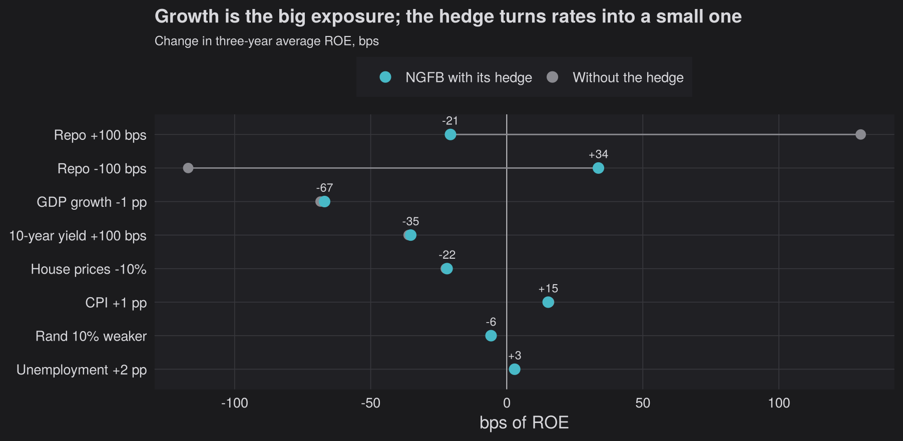

-   **Rates.** A repo path 100 bps higher costs hedged NGFB 21 bps of ROE, and 100 bps lower adds 34 bps. Without the hedge the same shocks would move it by +130 bps and -117 bps. The hedge was sized in Post 3 for deposits that reprice more slowly than the industry models now find, so it more than neutralises the endowment and leaves NGFB modestly liability-sensitive. That sounds like a technicality. It is the first hint that the hedge is a position rather than a hedge.
-   **Growth.** One point less GDP growth for three years costs 67 bps (R2.6bn of net income), 71 bps of it through credit losses. This is NGFB's largest exposure by a distance.
-   **The long bond, house prices, the rand and inflation.** A ten-year yield 100 bps higher costs 35 bps, a 10% fall in house prices 22 bps, a rand 10% weaker 6 bps. A point more inflation *adds* 15 bps, because fee income tracks nominal activity. It may be the only line on a bank's income statement that is pleased to see inflation.
-   **Unemployment** barely registers (+3 bps). Not because unemployment is harmless, but because no credit-loss relationship with unemployment survived testing once GDP was in it. The South African series moves too slowly, and too noisily, to identify a separate channel, so in this engine a labour-market shock shows up only through its GDP counterpart.

## Positioning before the scenario arrives

The other two ALCO questions are about action. The decision here is a set of balance-sheet moves made at the jump-off, each one unit in size: shift one percent of total assets out of HQLA into one of six lending books, replace one percent of wholesale funding with one of three kinds of deposit, or change the receive-fixed hedge by one percent of non-maturity deposits. The engine is the source of truth, and around the status quo it is close to linear in the moves. So for every scenario $s$ the gradient $G_s$, how much one unit of each move adds to three-year ROE, comes from re-running the engine with each move nudged half a unit up and half a unit down.

The naive thing is to maximise the engine's ROE, and it immediately embarrasses itself. Even with execution costs it grows every lending book out of HQLA, pushes four of the six to their upper bounds and claims 324 bps of probability-weighted ROE, the kind of number that wins a consultant a second engagement. The engine prices a new rand of lending at the book's *average* yield, loss rate and cost ratio, and holds equity fixed, so every risk asset looks better than HQLA. Whether NGFB should simply be bigger in cards is a franchise question (marginal pricing, cost to serve, adverse selection) that public data cannot answer. The positioning question is narrower and answerable: what should change *because* scenario X is coming?

So the status quo is taken to be optimal under the baseline, which is what a balance sheet built for the bank's central plan ought to be. That reveals an implied marginal cost for every move, $c = G_{\text{baseline}}$. If the plan is right at the margin, whatever one more unit of a move would add under the baseline must be exactly offset by costs the engine cannot see. It is the trick Black and Litterman used to back implied returns out of market weights (Black and Litterman 1992). Instead of asking the model what the balance sheet should be, ask what the model must believe for the current balance sheet to be right, and trade only on departures from that. Positioning then trades on how a scenario *changes* each move's value:

$$\max_{x}\;\; \sum_s w_s\Big(R_s + (G_s - c)^{\top}x\Big) \;-\; \frac{\lambda}{2}\,\mathrm{Var}_w\big(R + Gx\big) \;-\; \sum_k \kappa_k\,x_k^2 .$$

$x$ is the vector of moves, $R_s$ the ROE in scenario $s$ if nothing moves, $w_s$ the scenario probabilities, and $(G_s - c)$ the extra value one unit of each move adds in scenario $s$ over and above the baseline. The middle term penalises spreading the outcomes across scenarios, with $\lambda$ setting how much; a bank that cares only about the average sets $\lambda = 0$. The last term is execution cost: pricing concessions and acquisition costs to grow a book within a year, attrition to shrink one. It is quadratic, so a two-unit move costs four times a one-unit move, which is roughly how franchises behave when you try to rush them. The moves are bounded, and the CET1 (11.5%) and LCR (120%) floors must hold.

| Move | From | Unit | Bounds | Execution cost of one unit | Worth under the baseline (implied cost) |
|:-------------|:---------|:-------|--------:|-------------:|-------------------:|
| Residential mortgages | HQLA | 1% of assets | -2.0 to +2.0 | 8.0 bps | +40.9 bps |
| Vehicle and asset finance | HQLA | 1% of assets | -2.0 to +1.5 | 8.0 bps | +42.4 bps |
| Credit cards | HQLA | 1% of assets | -1.5 to +1.0 | 15.0 bps | +58.4 bps |
| Personal loans | HQLA | 1% of assets | -1.5 to +1.0 | 15.0 bps | +60.9 bps |
| Corporate loans | HQLA | 1% of assets | -2.0 to +2.0 | 8.0 bps | +47.2 bps |
| Commercial property | HQLA | 1% of assets | -1.5 to +1.5 | 8.0 bps | +36.3 bps |
| Term deposits | Wholesale funding | 1% of assets | -2.0 to +2.0 | 4.0 bps | +7.3 bps |
| Savings deposits | Wholesale funding | 1% of assets | -1.0 to +1.0 | 8.0 bps | +17.0 bps |
| Transactional deposits | Wholesale funding | 1% of assets | -1.0 to +1.0 | 12.0 bps | +34.8 bps |
| Structural hedge | -- | 1% of NMD | -25.0 to +25.0 | 0.2 bps | +2.9 bps |

With one scenario treated as certain and nothing binding, the problem falls apart into one small problem per move, and each has a closed form. For move $k$, maximise $(G_{X,k} - c_k)\,x_k - \kappa_k x_k^2$. The benefit rises in a straight line, the cost in a parabola, and the best move is where one more unit adds exactly as much benefit as cost:

$$x_k^{*} \;=\; \frac{G_{X,k} - c_k}{2\,\kappa_k}, \qquad \text{net gain} \;=\; \sum_k \frac{(G_{X,k} - c_k)^2}{4\,\kappa_k} .$$

In words: move in the direction the scenario shifts the move's value, by an amount proportional to how far it shifts it, and inversely proportional to how expensive the move is to execute. Every result is then re-run through the full engine, which captures what the linear model misses (moves compound with growth, equity builds), and reported net of both the implied and the execution cost.

Take the hedge, because it does most of the work. Under the baseline one more point of hedge earns +2.9 bps of ROE, so that is its implied cost. Under the downside it earns -0.8 bps, because the floating leg it pays reprices up with the hikes. The net gradient is -3.7 bps a point and the execution cost 0.2 bps per point squared, so the optimum is $-3.69 / (2 \times 0.2) = -9.2$ points of non-maturity deposits, taking the hedge from 49.6% to 40.3%.

The rest of the downside positioning follows the same logic. Deposits gain value in a hiking cycle, because their cost lags the policy rate, so 0.53% of assets of wholesale funding is swapped for savings and transactional deposits. Unsecured lending loses value as losses rise, so cards and personal loans are trimmed by 0.46% of assets. Nothing hits a bound or a floor. Positioned, NGFB's downside ROE improves by +21 bps, or +R849m of net income over three years. That recovers 8% of the downside's 253 bps hit. Positioning cannot undo a credit cycle inside a year, and credit is what drives the downside.

Before the upside everything reverses: extend the hedge by 6.3 points to 55.8%, since its floating leg now reprices down, let 0.37% of assets of deposits go, and grow cards and personal loans by 0.24% of assets. That earns +9 bps if the upside comes.

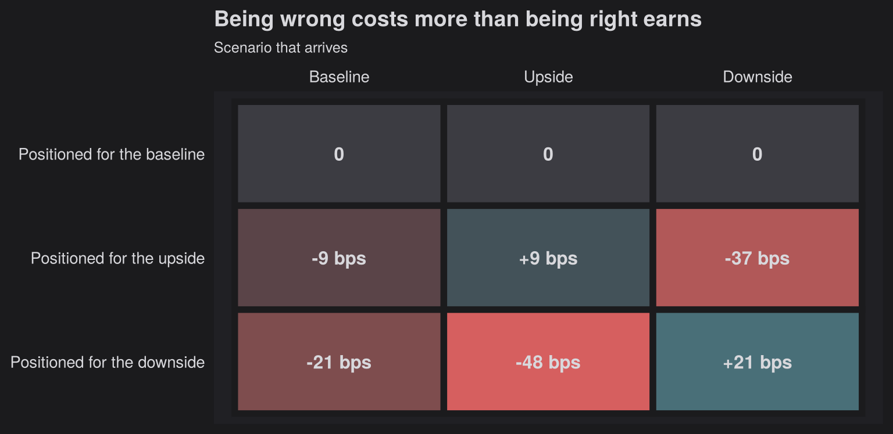

Every positioning is a bet, and the honest way to present one is with its cost of being wrong alongside, not in an appendix in eight-point grey. Position for the downside and get the baseline instead, and it costs 21 bps. Get the upside instead, and it costs 48 bps, or R1.8bn of net income. The upside positioning costs 9 bps if the baseline arrives and 37 bps if the downside does. So being wrong costs 2.3 times what being right earns for the downside positioning, and 4.0 times for the upside's. The two positionings are opposite bets on the same levers, which means a bigger bet on one scenario is automatically a bigger bet against the other.

The downside's single most important judgement is the SARB's response. Rerun the same contraction with 150 bps of cuts and the optimal hedge move flips sign, +9.1 points instead of -9.2, because the hedge becomes NGFB's protection rather than its cost. The credit leg does not flip: cards and personal loans are cut either way. The credit side of a downside positioning is robust to the policy response. The rate side is a bet on it.

What if there is no strong view? With the probabilities used here (50% baseline, 20% upside, 30% downside) and a variance aversion of $\lambda = 4$, the probability-weighted positioning trims the hedge by 1.8 points of non-maturity deposits and moves no other line by more than 0.06% of assets. The upside and the downside largely cancel, and when a bank genuinely does not know which is coming, the best response is close to the plan. The framework's value runs the other way. It tells the ALCO what to do, and what it costs if it is wrong, *as conviction about a scenario builds*. Positioning scales almost linearly with conviction until something binds.

Which leaves the question every ALCO eventually asks: what if we were braver? There are two different dials, and they behave differently. The first is to make bigger moves at the same cost. Scale the optimal move by a factor $\alpha$, and the benefit if the scenario arrives grows in proportion to $\alpha$ while the execution cost grows with its square:

$$\text{net gain}(\alpha) \;=\; \alpha\,(G - c)\,x^{*} \;-\; \kappa\,\alpha^2 x^{*2} \;=\; (2\alpha - \alpha^2)\,\frac{(G-c)^2}{4\kappa} .$$

The gain peaks at the optimum ($\alpha = 1$), is gone at twice the optimal size, and turns negative beyond. Meanwhile the loss if the scenario does *not* arrive keeps growing all the while, and faster than the gain ever did.

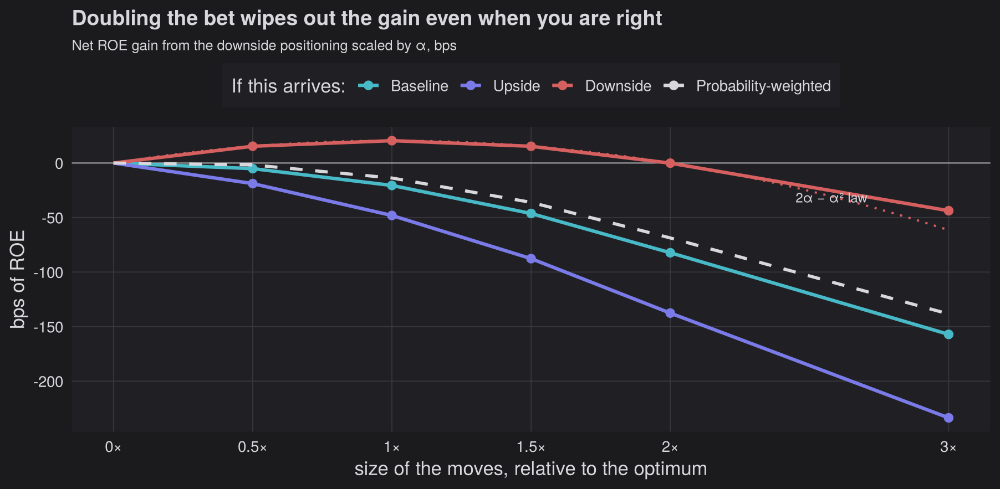

Doubling the optimal moves leaves nothing even if the downside arrives, and loses 138 bps if the upside does. The second dial is a bank that can execute more cheaply: one with a deposit franchise to spare, an underwriting machine ready to scale, or simply more time. The optimiser then chooses bigger moves. At a quarter of the execution cost the downside positioning makes +75 bps if the downside comes, but loses 126 bps if the upside does. Either way, the loss if wrong grows faster than the gain if right. And with a 30% chance of the downside, the probability-weighted value of full-conviction positioning is negative at every size. Positioning ahead of a downside is like packing an umbrella for a Highveld afternoon: cheap and sensible, and it will not stop the hail.

## Where NGFB should lean in

The positioning moved the balance sheet ahead of a scenario. Underneath it sits a commercial question: in which products, and in which phases of the cycle, does NGFB grow more slowly than its market and its peers, and is it worth fixing?

Two numbers place NGFB in each product and regime. The first is how fast the market grows in that regime, from the industry's history; no bank controls it. The second is NGFB's *share effect*, how much faster or slower than the market its book grows, from Stage 2. And because Stage 2 is a population, it also supplies a yardstick for the share effect: **par**, the typical large bank (the population mean); the **frontier**, a top-quintile large bank (the 80th percentile of the population's predictive distribution); and NGFB's percentile between them. Only population quantities are used, never an individual bank's estimate.

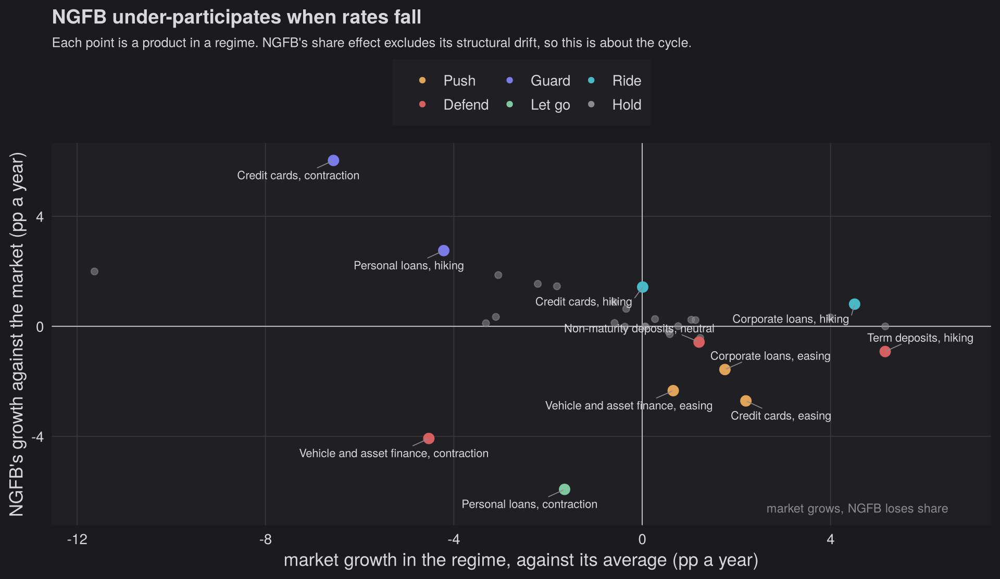

The rules that turn a cell into an action are economic, not statistical. **Push** where NGFB loses share in a regime when its market grows at or above its average: that is under-participation, the cheapest growth NGFB forgoes. **Defend** where it loses share in a weak market for a secured or funding product, because competitors are taking good-quality business, or loses deposit share in a growing deposit market, because that is funding it will later buy wholesale. **Guard** where it gains unsecured share while the market weakens: check that it isn't booking the business everybody else is declining. **Let go** where it cedes unsecured share in a contraction, which is risk appetite doing its job. **Ride** gains in a growing market, with capacity and pricing discipline.

The gap is in easing cycles. When rates fall, the card market grows 9.1% a year against an average of 6.9%, yet NGFB's card book grows 2.7 points a year more slowly than the market (46th percentile). It is not alone, since the typical large bank also loses 2.2 points a year of card growth in an easing cycle, and the Challengers take 100% of what NGFB gives up. Corporate loans (-1.6 pp, 34th percentile) and vehicle and asset finance (-2.3 pp, 40th percentile) follow the same pattern. In hiking cycles it reverses, and NGFB gains card share (+1.4 pp a year). The problem a bank might expect, losing cards when rates are high, is not NGFB's problem. Losing them when rates fall is.

Is it worth pushing? Share is worth buying only if the extra business earns more than it costs at the margin, and the scenario engine is the wrong tool for that, because it grows the whole bank along with the loan book. So each product's marginal economics are built up directly, per rand of balance:

$$\text{headroom} \;=\; r \;-\; f \;-\; \ell\,(f - r_{H}) \;-\; \text{EL} \;-\; \frac{k\,\rho\,\big(\text{CoE} - (1-\tau)\,f\big)}{1-\tau} .$$

A rand of new lending earns its rate $r$. It costs the marginal funding rate $f$, the funds-transfer price. It also costs the liquidity that funding needs: a quarter ($\ell = 25\%$) of a rand of wholesale funding must sit in HQLA earning $r_H$ rather than $f$. It loses its expected credit loss, EL. And it ties up capital: at a 12.5% CET1 target ($k$) and the product's risk weight $\rho$, that capital costs the 14.5% cost of equity less the after-tax funding it saves, and dividing by $1-\tau$ grosses the charge up to a pre-tax rate like everything else. What is left is the **headroom**: the most the business could cost to originate and service before it destroys value. The returns carry no costs by product, so this is the honest form of the answer. In the table below every column is in percent a year of the balance, and the headroom is the rate less the other four.

| Product | Rate (%) | FTP (%) | Liquidity | Expected loss | Capital charge | Headroom, wholesale funding (pp) | Headroom, own deposits (pp) |
|:------------|----:|----:|-----:|-------:|-------:|---------------:|-------------:|
| Credit cards | 15.28 | 7.90 | 0.66 | 4.31 | 0.71 | +1.70 | +4.13 |
| Personal loans | 18.21 | 7.90 | 0.66 | 7.00 | 0.78 | +1.87 | +4.29 |
| Corporate loans | 10.60 | 7.90 | 0.66 | 0.57 | 0.57 | +0.91 | +3.36 |
| Vehicle and asset finance | 10.68 | 7.90 | 0.66 | 1.29 | 0.78 | +0.05 | +2.46 |
| Home loans | 9.36 | 7.90 | 0.66 | 0.27 | 0.35 | +0.19 | +2.69 |
| Commercial mortgages | 9.16 | 7.90 | 0.66 | 0.38 | 0.72 | -0.49 | +1.94 |

Cards clear the bar comfortably even on wholesale funding (+1.7 pp of headroom). Corporate lending clears it only narrowly (+0.9 pp) and vehicle and asset finance barely at all (+0.05 pp), but funded with deposits both have 3.4 and 2.5 pp to spare. The lesson is the same for every secured product: at NGFB's margins, lending growth pays when it brings its own funding.

The guard case is cards in a contraction. NGFB gains card share (+6.0 pp a year, 75th percentile) while the card market all but stops (0.3% a year). At the average card loss rate the extra book still pays, but in the downside its headroom on wholesale funding is only 0.7 pp. If the accounts won in a downturn lose more than that above the average card loss rate, the share gain destroys value, and adverse selection makes that likely: in a contraction, the customer walking in is often the one other banks have just declined. The action is to tighten underwriting on new card business when GDP turns, not to celebrate the share.

## The tide and the swimming

The same split turns into a way of judging performance. A product's growth is the market's growth plus the bank's share effect. The first part is the macro environment, which no bank controls. The second is what management controls, and Stage 2 says what a typical large bank achieves in the same regimes. So a macro-adjusted target for product $p$ in quarter $t$ is

$$\text{target}_{p,t} \;=\; \underbrace{g^{\text{market}}_{p,t}}_{\text{realised, from the returns}} \;+\; \underbrace{\text{par}_p(\text{regime}_t)}_{\text{Stage 2}} \;+\; \text{ambition}_p ,$$

and performance is actual growth less the target. The market term is measured after the fact, so a bank is neither punished for a recession nor rewarded for a boom. The par term allows for what a typical large bank does in that phase of the cycle. The ambition is management's choice. Set in advance, the target becomes scenario-contingent. Looked back on, it separates the tide from the swimming. Warren Buffett's version is that you only find out who has been swimming naked when the tide goes out; a macro-adjusted target finds out while the tide is still in.

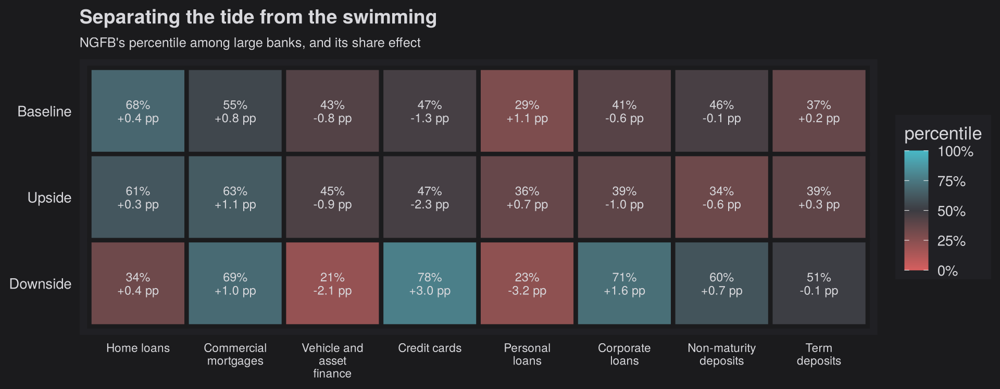

In the downside most of the slowdown in NGFB's books is the market's. Even so, NGFB is below par in home loans (34th percentile), because a typical large bank gains mortgage share in a contraction as lenders retreat to secured credit, and NGFB gains less. Cards sit near the frontier (78th percentile), which is exactly the guard case above, a reminder that a high percentile is not automatically good news. In the upside the growth is in cards, corporate lending and vehicle finance, and NGFB is below par in all three. The upside's message for management is to protect share where the growth is, not to bank the tide.

## Are the numbers right?

Every number in this post is computed inline and guarded: the render fails if a rebuild moves one far enough to change a sentence. That checks the arithmetic. It does not check the inputs the arithmetic takes on trust, and when I went looking, two of them were wrong.

### The hedge was priced off the wrong curve

Until free swap data turned up, the hedge's swap rates came from a proxy built inside the government curve:

$$s^{\text{proxy}}_{5} \;=\; \text{JIBAR} \;+\; 0.55\,\big(y^{\text{gov}}_{10} - \text{JIBAR}\big),$$

the three-month rate plus a fixed share of the ten-year bond's spread over it. It looks innocent and is not. Daily JIBAR swap fixings are now published by rbond.co.za (rbond.co.za 2026), and against them the proxy fails in every quarter.

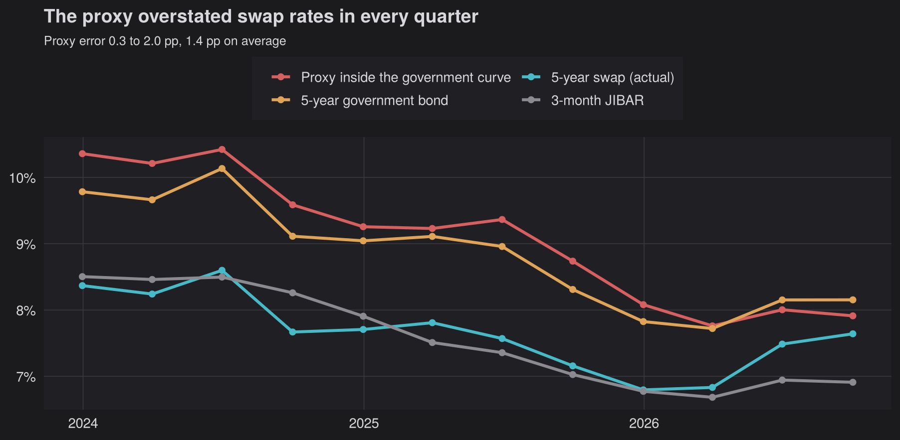

The proxy overstated the five-year swap rate by 0.3 to 2.0 percentage points, 1.4 on average. The reason is structural rather than noise. South African government bonds pay a fiscal premium over swaps, the price of the tight link between the sovereign and the banks that hold its paper (Hesse and Miyajima 2022), and a curve built inside the bond curve inherits it. Pricing a swap off the bond curve is like pricing a Polo's insurance off a Range Rover's quote: same road, different risk. Priced off actual fixings, the hedge book's fixed rate falls from 8.87% to 7.60%, and NGFB's baseline ROE by 265 bps (R10.4bn of net income over three years). It was the largest single correction in this project, and it changed the story: before it, NGFB appeared to out-earn the sector, and that was mostly the proxy's excess carry, not the hedge.

### A broken equity series

Equity-price growth is a candidate driver in several of the industry models, standing in for household wealth and business confidence. The SARB all-share series that fed it had three level breaks that are not market moves: -42% in March 2017, -39% in October 2021 and +43% in March 2023, months in which the OECD's all-share index for South Africa moved -0.6%, +2.6% and -4.1%.

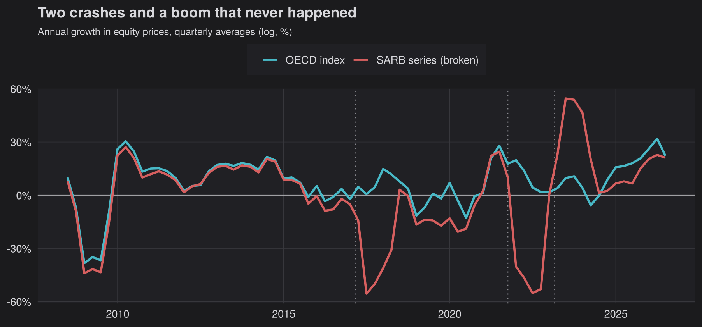

In annual growth the breaks became gaps of up to sixty points. The models were seeing equity crashes of 40--55% through 2017--18 and 2021--22, and a 50% boom in 2023, none of which happened; anybody who held the JSE through 2023 would have noticed a 50% year. Equity growth now comes from the OECD index (Organisation for Economic Co-operation and Development 2026), the panel build stops if annual equity growth ever exceeds 45% again, and every model was re-estimated on the clean series. Data checks are unglamorous. They are also the only part of a modelling project that the models themselves cannot do.

### How rate-sensitive is NGFB, really?

Banks publish the effect of a parallel 100 bp move on their next twelve months' net interest income, which gives a yardstick. The engine's equivalent moves every rate by 100 bps on the static balance sheet, with deposit costs and loan spreads following their projected pass-through. Unhedged, NGFB is asset-sensitive like the sector (+6.4% of NII against the sector's +6.3%), and more so than one large South African bank's 2025 disclosure (3.5%). With its hedge, NGFB is *liability*-sensitive (-1.2%), which is not what large South African banks report. The published bank hedges about R14bn of its endowment; NGFB hedges R346bn.

The canonical hedge ratio was sized in the deposit posts for slower deposit repricing than the industry models now find. With faster repricing, the ratio at which a 100 bp move leaves first-year NII unchanged falls to 37% of non-maturity deposits. By that yardstick NGFB is over-hedged: belt, braces and a second belt. File that away; it comes back.

### JIBAR's end

The engine prices ten quarters beyond JIBAR, so the transition is modelled rather than assumed away. The SARB's Market Practitioners Group set the timetable in December 2025 (South African Reserve Bank, Market Practitioners Group 2025): no new JIBAR-linked contracts from 1 May 2026; cleared JIBAR swaps converted by the clearing houses into ZARONIA overnight-index swaps in late November 2026, keeping their fixed rates, with the floating leg paying compounded ZARONIA plus 16.19 bp (CME Group 2026; South African Reserve Bank 2023a); and the last JIBAR fixing on 31 December 2026, after which contracts that still reference it fall back to compounded ZARONIA plus the same credit adjustment spread.

That spread, the CAS, is the five-year median of three-month JIBAR less compounded ZARONIA. Over the 36 months of daily data the basis averaged 0.17 pp, between 0.06 and 0.27 pp as monthly averages.

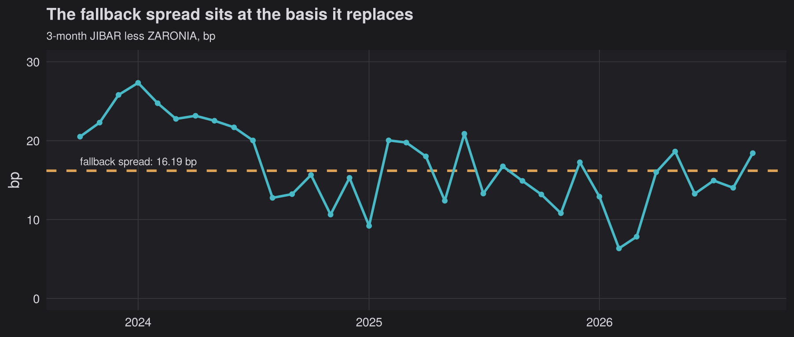

Because the CAS is the long-run median of the basis it replaces, the switch is level-neutral by design: against a run that keeps JIBAR going to 2029, NGFB's baseline ROE moves by +1.3 bps. What changes is risk, in three ways.

-   **The basis stops floating.** A three-month term rate carries the market's expected policy move over the coming quarter and the banks' own term and credit premium. ZARONIA compounded in arrears carries neither, and the CAS is fixed. NGFB pays the benchmark on net (R313bn of floating assets against R85bn of floating funding and a hedge notional of R346bn), so each 10 bp widening of the basis used to cost it about R118m of annual NII, and from 2027 costs nothing. Funding stress does not disappear. It moves into the spreads at which banks issue paper over the overnight rate.
-   **The spread is at risk on the asset side.** Converted and fallback contracts keep the 16.19 bp, but loans re-papered onto ZARONIA are priced in negotiation, and a borrower quoted "ZARONIA plus the old margin" has quietly pocketed the CAS, and will be telling the story at year-end functions for years. If NGFB lost it on every floating-rate asset from 2027, its ROE would fall by 32 bps. Pricing new ZARONIA business at all-in parity is worth exactly that.
-   **The hedge is unaffected.** The clearing houses keep each swap's fixed rate and pay ZARONIA plus 16.19 bp on the floating leg, so the book's carry does not change.

One more check, on a channel the engine does not have. A recession could widen bank funding spreads beyond anything the benchmark captures, and once the benchmark is an overnight rate, that is the only place funding stress can show up. I regressed the sector's NCD spread over JIBAR on its own lag and the repo change, adding GDP growth, unemployment, a contraction kink, the curve's slope and the ten-year yield one at a time. None is significant. What moves the measured spread is mechanical: when the SARB cuts, the average cost of the NCD book lags JIBAR down and the spread widens for a few quarters. The one genuine funding shock in the sample, the global squeeze of late 2008, arrived before South Africa's GDP turned. Funding stress keeps its own diary. So a funding shock is a stress overlay, not a scenario relationship: 100 bps on wholesale funding and NCDs costs NGFB 151 bps of ROE.

## More levers, and a map of what drives them

The positioning moved the balance sheet's mix. An ALCO has more levers than that, and most of them are rate, spread, liquidity and capital decisions that a macro view should drive directly. Each one below is run through the full engine in every scenario, against NGFB's plan, in the order an ALCO sets them.

| Lever | The decision | The premium it earns | Its macro signal | The risk it takes, and where it shows |
|---------------|---------------|---------------|---------------|---------------|
| Hedge ratio | share of non-maturity deposits received fixed | fixed over floating: a view on the policy path | the policy rate against neutral (R1) | rates rise: NII and EVE |
| Reinvestment tenor | tenor at which maturing swaps are replaced | the swap curve's term premium | the policy rate against neutral (R2) | today's rates locked in for longer: EVE |
| Ten-year bonds in HQLA | share of the buffer held in ten-year government bonds | the term premium and the fiscal premium | the curve's slope (R3) | the long bond sells off: OCI, CET1, EVE |
| Asset-swapped bonds | share held in five-year bonds swapped to floating | the fiscal premium alone | the bond--swap spread (R6) | the spread widens: OCI and CET1 |
| Size of the buffer | Treasury bills released to repay wholesale funding | wholesale funding's cost over the bills' yield | stress: GDP or the rand (R7) | less liquidity going into a stress: LCR, NSFR |
| Payout | share of profit paid out | equity returned: a smaller ROE denominator | growth and capital (R4) | a thinner cushion into a downturn: CET1 |
| Unsecured growth | card and personal-loan growth | volume and margin | the labour market (R5) | credit losses |

Read down, the map is the order of an ALCO's decisions: first how much of the deposit franchise's rate sensitivity to convert to fixed, then how to hold the liquidity regulation requires and how much of it to hold, then how much capital to keep. Read across, it says why each lever has its own macro signal. Each earns a different premium, and a premium is worth collecting when it is large. It also says why the levers must be chosen under limits, because every setting that earns more takes a risk the three-year ROE does not price, and the risks land in different places. The R-numbers are the macro-keyed rules tested in the lab further down.

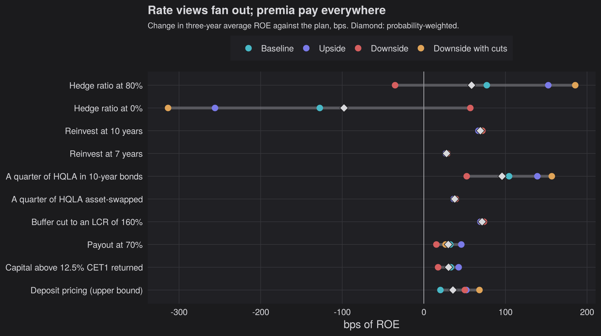

### The hedge ratio is a rate view

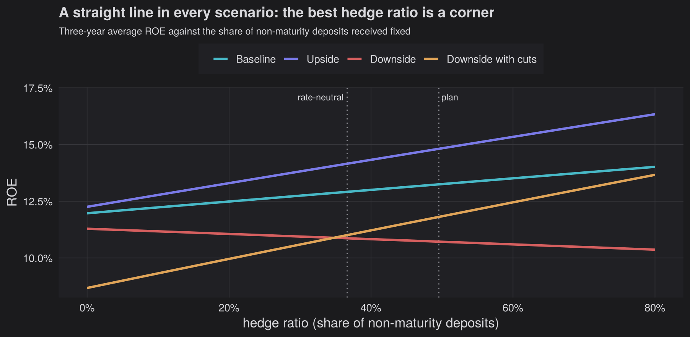

A receive-fixed swap earns its fixed rate and pays the floating benchmark. So more hedge pays in every scenario in which the benchmark falls below the rate the swap was struck at, and costs in every scenario in which it rises above. ROE is therefore a straight line in the hedge ratio, and the best ratio is always a corner: as much hedge as policy allows if your view is the baseline, the upside or a downturn with cuts, and none at all if your view is the stagflationary downside. Each ten points of non-maturity deposits received fixed adds 26 bps of ROE in the baseline and costs 12 bps in the downside. At the scenario weights more hedge wins, because the five-year swap at the jump-off (7.49%) priced the SARB's 2026 increases but not the baseline's later cuts. That is the bank's rate view against the market's, and it should be sized as a bet. The structural answer is the rate-neutral 37%, where earnings move least with a parallel shift.

### Reinvestment tenor: the term premium

One twentieth of the hedge matures every quarter, so within three years three-fifths of the book is reinvested. Reinvest at ten years instead of five and each tranche earns the swap curve's term premium, about 1.0 point a year more over 2023--2026, which is worth +69 bps of ROE in every scenario alike. It is not free. The book's PV01, the change in its value for a one basis point move in rates, rises by 83%, so the economic value of equity becomes more sensitive to rates, the interest-rate-risk limits (Basel Committee on Banking Supervision 2016) bind sooner, and today's rates are locked in for longer. Seven years is the halfway house (+28 bps, +37% PV01).

### Ten-year bonds in the buffer: the term and fiscal premia

NGFB's liquidity buffer sits in Treasury bills and cash. Level 1 government bonds count the same towards the LCR (Basel Committee on Banking Supervision 2013), and South Africa's curve pays about two points for the duration: the ten-year bond yielded 8.87% in the jump-off quarter against 6.94% for three-month JIBAR. Moving a quarter of the buffer into ten-year bonds adds +96 bps of probability-weighted ROE, most where the long yield falls (+157 bps in a downturn with cuts) and least in the stagflationary downside (+53 bps).

The price shows up somewhere the ROE does not look, and it needs a word on accounting. Banks usually hold their liquidity bonds at fair value through other comprehensive income (FVOCI) under IFRS 9 (IFRS Foundation 2014). The coupon runs through net interest income like any other asset's. The price change does not touch profit while the bond is held: it sits in the OCI reserve inside equity, and that reserve counts in CET1. Sell the bond and the accumulated gain or loss is recycled from the reserve into profit. And because Level 1 assets count in the LCR at market value, a price fall shrinks the buffer too. So a long bond in the buffer earns its carry in the income statement and takes its price risk in capital and liquidity, like a lodger who pays the rent on time and now and then floods the bathroom. At the downside's peak the mark-to-market costs 111 bps of CET1, and a sovereign shock larger than the scenario's (2015 and 2020 both moved the long bond by more) would cost more.

### Asset-swapped bonds: the fiscal premium without the duration

A ten-year bond held for liquidity earns two premia over bills. The *term premium* is the reward for interest-rate risk. The *fiscal premium* is what South African government bonds pay over the swap curve, the reward for sovereign and supply risk. An asset swap separates them. Buy a five-year government bond yielding $y^{\text{bond}}_5$ and, against it, pay fixed on a five-year swap at $s_5$ while receiving the floating benchmark $f_t$. The bond's coupon goes out through the swap's fixed leg and the benchmark comes back through its floating leg, so what is left is a floating-rate asset paying the benchmark plus the *bond--swap spread*, $bs = y^{\text{bond}}_5 - s_5$. Against the Treasury bill it replaces, each rand earns

$$\text{carry} \;=\; \underbrace{y^{\text{bond}}_{5} - s_{5}}_{\text{bond–swap spread, locked in at purchase}} \;+\; \underbrace{f_t - y^{\text{bill}}_t}_{\text{the bills' discount to the benchmark}} .$$

In the jump-off quarter the five-year bond yielded 8.15% against a five-year swap of 7.49%, a spread of 0.67 pp, and bills yield about 0.15 pp under the benchmark. That is a pickup of roughly 0.8 pp a year, and none of it depends on where the policy rate goes.

It does depend on the spread, and a scenario says nothing directly about the spread: it carries the ten-year yield and the floating benchmark, not a swap curve that prices the policy path. So the spread is modelled, from one piece of economic logic. Both curves price the expected path of the policy rate, so a policy-driven move should leave their difference alone. What is left of a move in the long bond once the policy part is stripped out is the fiscal premium and global yields, and the spread should absorb some share of that:

$$\Delta bs_t \;=\; \kappa\,\Big[\,\Delta y^{\text{gov}}_{10,t} \;-\; \beta\,\Delta f_t\,\Big] .$$

$\beta$ is how far the ten-year yield moves for each point of the floating benchmark. It is only 0.15 (three-year changes since 2005, $t$ = 2.8): the long end barely follows the policy rate. $\kappa$ is the share of the *remaining* move that lands on the bond--swap spread, 0.26, estimated on monthly levels since late 2023 ($t$ = 5.3, $R^2$ = 0.76). About a quarter of a fiscal or global sell-off in the long bond shows up in the spread, and the swap curve moves with the rest. Month-on-month changes give a smaller 0.11, short-run noise that does not accumulate; for a book held for years, the level relationship is the relevant one, and the larger number is also the more prudent. The model does miss the most recent months, when swap rates rose faster than bond yields as the market began to price the SARB's hikes and the spread compressed further than the long bond's level implies.

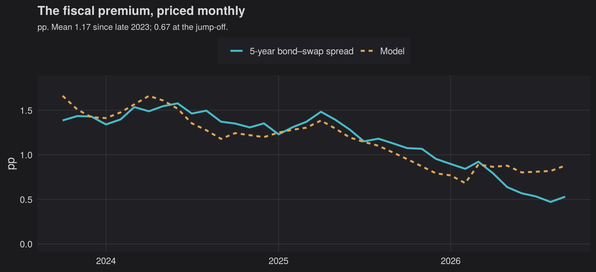

What the asset swap does to the risk measures is the reason it matters later. **Economic value of equity: nothing.** The swap carries the bond's interest-rate sensitivity away, so the position uses none of the EVE budget. **Spread: everything.** What is left is credit-spread risk in the banking book. If the fiscal premium widens, the bond falls against the swap; with the bond at FVOCI and the swap designated as a hedge of its rate risk, the rate parts offset and the spread part sits in the OCI reserve, and so in CET1. The book's spread PV01 is R29.5m per basis point, so a 100 bp widening at the jump-off, about four times the largest rise since the swap data begin, would cost 35 bps of CET1 after tax. **Liquidity: a little.** A government bond is Level 1 like a bill, so buying it does not move the LCR, but a spread widening lowers the buffer's market value. A rate-driven price fall does not, because the cleared swap pays it back daily as variation margin.

A quarter of the buffer (R73bn) in asset-swapped bonds adds 37 bps to 39 bps of ROE in every scenario, because its income does not care about the policy path. The stagflationary downside's sovereign stress widens the spread to 1.21 pp at its worst, which costs 16 bps of CET1 through OCI, about a seventh of the ten-year book's 111 bps, for 40% of its return. The ten-year book earns more because it also collects the term premium, and the term premium is paid for interest-rate risk that the asset swap does not take. It is the closest thing in this post to a free lunch, and like every free lunch in Sandton, somebody else is paying: here, the sovereign.

### The size of the buffer: what surplus liquidity costs

NGFB's LCR starts at 191%, against the 150% the sector publishes and the 120% NGFB sets as its own floor. The surplus sits in Treasury bills, and at the margin it is funded with wholesale funding, so every rand of it earns the bill rate and costs the wholesale rate. That negative carry averages 1.32 pp a year over the baseline, about R13m before tax for each R1bn. Release bills and repay wholesale funding with them, and the saving is roughly nine basis points of ROE per R10bn, the same in every scenario, because it is a spread rather than a rate view. Cutting the LCR to 160% releases R78bn and adds +71 bps. The lowest LCR across the scenarios is then 152% and the lowest NSFR 125%, both far above their floors. What stops the release is not a ratio but the wholesale book itself. At 160% NGFB has repaid 92% of its wholesale funding, and releasing more would leave the bills with nothing dear to repay.

Surplus liquidity is the generator in the garage: you pay for it every month and resent it until the evening you need it. The engine does not stress run-offs, funding spreads or fire-sale prices, so it sees what the surplus costs but not what it buys. An LCR of 160% is still above the roughly 150% the sector holds, which the previous post found to be about the right size for a run on a quarter of the money that can actually leave. Even so, the release is a size decision for the bank's own liquidity stress test, not for the LCR alone.

### Capital and deposit pricing

The last two levers are quicker. NGFB starts with a CET1 ratio of 13.1% and builds capital at a 50% payout. A 70% payout adds +30 bps of probability-weighted ROE with the CET1 trough at 11.6%, close to the 11.5% floor, and returning the R4.9bn above a 12.5% target at the jump-off adds +30 bps. Payout is the natural macro-contingent lever: more in the upside, less going into a downturn, on the same principle as not booking Mauritius until the bonus has cleared. Passing 10% less of each policy-rate rise and 10% more of each cut to non-maturity deposit rates adds +36 bps, but that is an upper bound, because nothing in the engine prices the deposits it would lose.

Together, ten-year reinvestment, a quarter of HQLA in ten-year bonds and the capital distribution add +202 bps at the scenario weights, and CET1 stays above the floor in every scenario, with a trough of 12.0%. Unless, that is, the bonds are marked through OCI, in which case the downside's peak takes CET1 to 10.9%, below the 11.5% floor. Three levers that each look fine on their own do not fit together, and the reason shows up where the ROE does not look. Hold that thought too.

## The strategy lab: sixty-one histories

The scenarios ask *what if X happens*. A positioning decision also has to survive what nobody wrote down, and the most honest set of those outcomes a South African bank has is its own history. The lab replays every complete twelve-quarter macro episode since 2008, 61 overlapping windows from 2008Q2-2011Q1 to 2023Q2-2026Q1, from today's starting point, and runs each through the whole chain: industry models, NGFB's share dynamics, the engine. Rates, the long bond, inflation and unemployment move by the change they made in the episode. GDP, house prices, the rand and equities grow as they grew, compounded from today's levels, which stops an episode that starts in the base-effect quarters of 2020--21 from shifting its whole path.

This is historical simulation, the market-risk workhorse, applied to a balance sheet. No distribution is assumed, but only history's episodes can occur, consecutive windows share eleven of their twelve quarters, and the sample holds exactly one global financial crisis and one pandemic, which is two more than anybody wanted and still not many.

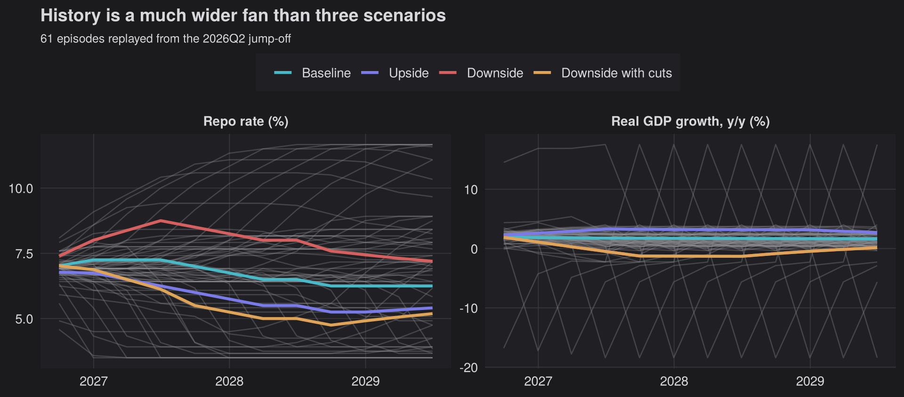

The episodes span far more than the scenarios do. The policy rate averages anywhere from 3.3 points below today's to 3.5 above (26 episodes with higher rates on average, 27 with lower, the rest broadly flat), average real GDP growth runs from -1.8% to 6.7%, and the deepest quarter is the pandemic's -18.4%.

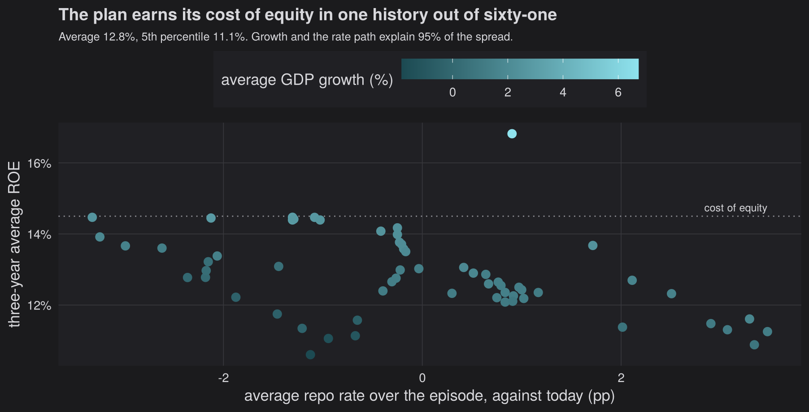

NGFB's plan averages 12.8% across the histories, between 10.6% (2018Q2-2021Q1, through the pandemic) and 16.8% (2020Q3-2023Q2, the rebound from it), with a 5th percentile of 11.1%. It earns the 14.5% cost of equity in one of the 61. Two macro numbers explain almost all of that spread. A regression across the episodes,

$$\overline{\text{ROE}}_e \;\approx\; a \;+\; b_{\text{gdp}}\,\bar g_e \;+\; b_{\text{repo}}\,\overline{\Delta r}_e ,$$

finds each point of average GDP growth $\bar g_e$ worth +81 bps of ROE and each point by which the policy rate averages above today's, $\overline{\Delta r}_e$, worth -35 bps: that is the liability sensitivity the hedge gives NGFB. Together they explain 95% of the variation. The regression is descriptive; overlapping windows make its precision look better than it is.

Each strategy is judged the way an ALCO would judge it: its average ROE across the episodes, its bad case (the 5th percentile), how often it beats the plan, and two risks the three-year ROE does not price. The first is the CET1 trough with any bonds at fair value, so that the OCI reserve counts. The second is interest-rate risk, measured the way the IRRBB outlier test measures it (Basel Committee on Banking Supervision 2016), as the change in the economic value of the hedge and bond books for a 200 bp rise:

$$\frac{\Delta \text{EVE}}{\text{CET1}} \;=\; \frac{200 \times \text{PV01}}{\text{CET1}} ,$$

where PV01 is the change in the books' value for a one basis point parallel move.

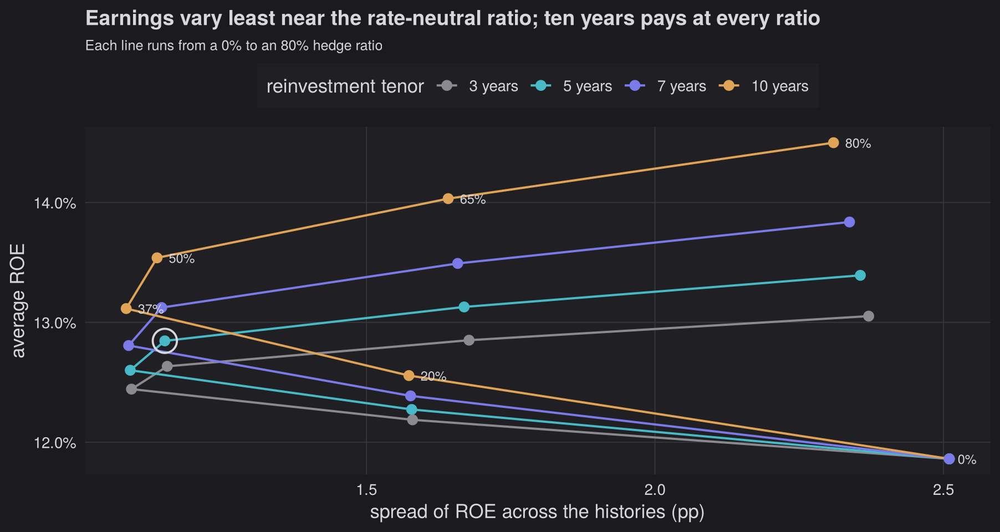

Three things stand out from the static hedge settings. **Earnings vary least near the rate-neutral ratio:** the spread across the histories is smallest at 37% reinvested at ten years (1.08 pp, against the plan's 1.15), because with more receive-fixed the hedge dominates and with less the endowment does. **Longer reinvestment pays at every ratio, whichever way rates go:** at the plan's ratio, ten years instead of five adds +69 bps on average and beats the plan in every episode, +70 bps when rates rise and +69 bps when they fall. Its cost is outside the ROE: a 200 bp rise would take a further 12.4% of CET1 off the books' value. **More hedge is a rate view:** receiving fixed on 80% of deposits at five years adds +55 bps on average, but -100 bps when rates rise and +199 bps when they fall, with a 5th percentile of -266 bps.

### Rules that read the macro picture

Static settings are chosen today and left alone. The lab's other question is whether settings that *respond* to the macro picture do better. Seven rules, one per lever, each reading only what was known at the end of the previous quarter:

| Rule | What it does |
|------------------------------------|------------------------------------|
| R1 hedge ratio | the plan's ratio plus 10 points of deposits for each point the policy rate stood above its 6.25% neutral level, within 20--80% |
| R2 reinvestment tenor | reinvest at ten years when the policy rate is at least half a point above neutral, at three years when half a point below, at five otherwise |
| R3 HQLA duration | a quarter of earning HQLA in ten-year bonds when the curve's slope (ten-year yield less the benchmark) is at its post-2008 median of 2.38 pp, an eighth more or less for each point above or below, within 0--50% |
| R4 payout | 70% of earnings while GDP grew last quarter and CET1 is above the 12.5% target, 30% otherwise |
| R5 unsecured growth | card and personal-loan growth 5 points a year faster while unemployment is falling and growth is above 1%, 5 points slower when unemployment has risen by more than a point over the year or GDP contracts |
| R6 asset swap | none of earning HQLA in asset-swapped bonds while the bond--swap spread is below 0.5 pp, a quarter at 1 pp, half at 1.5 pp or more |
| R7 liquidity buffer | bills released to an LCR of 170% in calm quarters, rebuilt to 185% after a quarter in which GDP contracted or the rand lost more than 15% over the year |

The parameters were set in advance as round numbers, not fitted to the episodes. Fitted on the same sixty paths, any rule would look better than it is, which is the backtesting equivalent of marking your own matric paper.

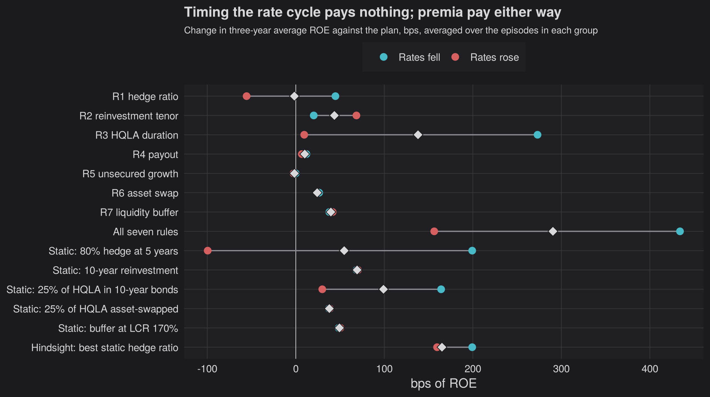

-   **R1, the hedge ratio keyed on the level of rates, adds nothing:** -2 bps on average, with a 5th percentile of -168 bps. It gains when a high rate is followed by cuts and loses when rates keep rising, and in history the two came about equally often. The prize is real, since choosing the right static ratio for each episode with hindsight would have added +165 bps, but the level of the policy rate does not reveal it. The rate cycle is the Comrades of forecasting: everybody has a split time, nobody has the finish.
-   **R2, the reinvestment tenor keyed on rates, pays less than always going long:** +44 bps against +69 bps for ten years throughout. Every quarter spent at three or five years gives up term premium that the timing never wins back.
-   **R3, HQLA duration keyed on the curve's slope, earns the most of any single rule, though not in every episode:** +138 bps on average against +99 bps for a fixed quarter of HQLA in bonds, with a better CET1 trough at fair value (11.9% against 11.4%) for the same EVE risk. A steep curve pays more carry and tends to flatten as long yields fall, so buying duration when the slope is high collects the bond's excess return when it is largest, which is the term-premium evidence of Fama and Bliss (1987) and Campbell and Shiller (1991) in South African data. The catch is that R3 trades its book, and a bond sold out of an FVOCI book takes its accumulated gain or loss into profit. Curves flatten most often because the SARB is hiking, when long yields rise too, so R3 sells at a loss in hiking cycles: its realised losses average R1,176m before tax over the episodes in which rates rose, against gains of R845m where they fell. It adds +10 bps when rates rise and +273 bps when they fall. Today's slope of 1.93 pp is below its median, so the rule would start at 19% of HQLA, not a quarter.
-   **R4, the payout keyed on growth and capital, adds a little and protects capital:** +10 bps with a CET1 trough of 12.3%, above the plan's 12.2%. A flat 70% payout adds +29 bps but takes 13% of the episodes below the 11.5% floor. Paying more when the economy grows and capital is ample, and less otherwise, keeps the capital where the downturns are.
-   **R5, unsecured growth keyed on the labour market, does nothing here** (-2 bps). The engine applies the industry's loss rate to the whole book, with no vintages, so the timing of origination cannot pay. A bank with its own vintage loss curves should run this test on them before concluding that credit timing is worthless.
-   **R6 and R7 beat the plan in every episode, and take no rate risk.** A static quarter of HQLA in asset-swapped bonds adds +38 bps with a 5th percentile of +37 bps; R6 adds +24 bps, because it holds little while the spread is as tight as today's. Releasing bills to an LCR of 170% adds +49 bps, and R7, which rebuilds the buffer after a stress signal (27% of the episodes' quarters), adds +40 bps. The difference between them is what the insurance costs.
-   **All seven together add +290 bps on average** and beat the plan in 93% of the episodes, lifting the share of histories in which NGFB earns its cost of equity from 2% to 72%. Most of that is duration, and so is most of the risk: a 200 bp rise would take a further 20% of CET1 off the books' value, and the CET1 trough at fair value falls to 11.51%, a whisker above the floor. Seven rules stacked without a budget use more of the bank's risk capacity than anybody set out to give them.

## Choosing the levers together, under a risk budget

That last result is the wrong way round. An ALCO does not pick strategies and then discover how much risk they take. It sets a risk appetite and asks what earns the most inside it. So the question becomes: given a risk budget, which combination of levers earns NGFB the most across the histories?

The objective is NGFB's three-year average ROE, averaged over the 61 episodes with each history weighted equally:

$$\max_{x}\;\; \frac{1}{61}\sum_{e=1}^{61} \overline{\text{ROE}}_e(x) .$$

$x$ sets six decisions: the hedge ratio and the reinvestment tenor (chosen together, because they interact), the share of earning HQLA in ten-year bonds, the share in asset-swapped bonds, the size of the buffer, and the payout. Each can be fixed today or follow its macro rule. The limits must hold in every quarter $t$ of every episode $e$:

| Limit | Condition | Why |
|------------------------|------------------------|------------------------|
| Tail | the 5th percentile of $\overline{\text{ROE}}_e(x)$ across the episodes is no worse than the plan's (11.1%) | a higher average bought with a worse bad case is a bet, not positioning |
| Capital | CET1, including the bonds' OCI reserve, at least 11.5% | the management floor, at fair value |
| Liquidity | LCR with HQLA at market value at least 120%; NSFR at least 110% | management floors above the 100% minima |
| Interest-rate risk | $\lvert \Delta\text{EVE}_{e,t}(x) - \Delta\text{EVE}_{e,t}(\text{plan})\rvert \le B$ of CET1, for a ±200 bp parallel shock | the plan is the bank's accepted position; $B$ bounds how far strategy moves it, in either direction |
| Liquidity book | ten-year bonds, asset swaps and released bills together at most 90% of earning HQLA | some bills stay for day-to-day liquidity management |

The EVE limit is relative to the plan for a practical reason. Without a behavioural model of the deposits' own economic value, the bank's total EVE is not measurable from public data, but the change a strategy makes to it is: that is the change in the value of the hedge and bond books. $B$ is the budget, and the central case sets it at 5% of CET1.

| Lever | Settings | Options |
|------------------------|------------------------|------------------------|
| Hedge ratio | 0%, 20%, 37%, 50%, 65%, 80%, R1 | 7 |
| Reinvestment tenor | 3 years, 5 years, 7 years, 10 years, R2 | 5 |
| Ten-year bonds (share of earning HQLA) | 0%, 12.5%, 25%, 37.5%, 50%, R3 | 6 |
| Asset-swapped bonds (share of earning HQLA) | 0%, 12.5%, 25%, 37.5%, 50%, R6 | 6 |
| Size of the buffer | the plan's (LCR 191%), LCR 180%, LCR 170%, LCR 160%, R7 | 5 |
| Payout | 30%, 50%, 70%, R4 | 4 |

That is $7 \times 5 \times 6 \times 6 \times 5 \times 4$ = 25,200 combinations. Running every one of them through the engine on every path would mean about 1.6 million engine runs, the strategic-planning equivalent of a queue at Home Affairs. It is also unnecessary, because of how the levers work:

1.  **Each setting on its own.** Every setting of every lever runs through the engine with everything else at the plan, on every path: the 61 episodes, the three scenarios and the variant. That is 52 runs per path. Each run keeps, quarter by quarter, net income, risk-weighted assets, the bond books' OCI reserve, the PV01 of the hedge and bond books, the LCR and the NSFR.
2.  **A surrogate for every combination.** A combination's changes against the plan are added up quarter by quarter, because the levers act on different parts of the balance sheet: the hedge on NII, the bond books on NII and OCI, the buffer on HQLA and wholesale funding. The exception is the payout, which acts on every rand the other levers add, so equity is rolled forward with the combination's own payout:
    $$\Delta\text{NI}_{e,t}(x) \;\approx\; \sum_{k} \Delta\text{NI}_{e,t}(x_k), \qquad E_{e,t}(x) \;=\; E_{e,t-1}(x) \;+\; \big(1-\pi_{e,t}(x)\big)\,\text{NI}_{e,t}(x) ,$$
    where $\pi_{e,t}(x)$ is the payout ratio: a fixed number, or rule R4 reading the combination's own CET1 ratio. ROE, CET1 and the EVE ratio are then computed from that equity. The surrogate reproduces every single setting exactly, and on every combination checked against the full engine it is within 0.03 bp of ROE.
3.  **Score everything.** All 25,200 combinations are scored on every episode and quarter, with minima and percentiles taken after adding, and the best feasible one is kept at each EVE budget. There is no search heuristic to get stuck: the frontier is exact for the grid.
4.  **Exact runs.** Every chosen combination is re-run through the full engine on every path, and the limits are checked on those runs, not on the surrogate.
5.  **Out of sample.** The optimum is chosen on the first 25 episodes and scored on the last 25, and the other way round. The eleven episodes in between share quarters with both halves and are left out.

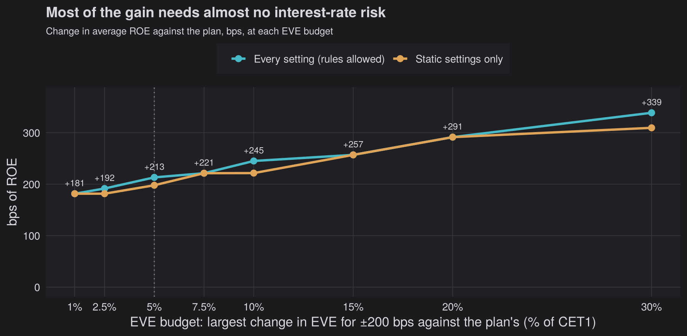

Most of the gain needs almost no EVE budget. With 1% of CET1 the best combination already adds +181 bps; at the central 5% it adds +213 bps, and the next five points of budget add only 32 bps more. The reason is that the largest levers are spreads, not duration: the asset swap and the smaller buffer take no interest-rate risk at all. Beyond 10% of CET1 the frontier buys ROE with duration, and the tail starts to give: at 30% the average gain is +339 bps but the 5th percentile gains only +123 bps, against +229 bps at 10%. Static settings alone come within 15 bps of the frontier at the central budget.

### The risk-budgeted portfolio

|  | Plan | Risk-budgeted | Static settings only |
|------------------|------------------|------------------|------------------|
| Hedge ratio | 49.6% of non-maturity deposits | 37% | 20% |
| Reinvestment tenor | 5 years | 7 years | 10 years |
| Ten-year bonds in HQLA | none | 12.5% of earning HQLA | 25% |
| Asset-swapped bonds in HQLA | none | 50% of earning HQLA | 37.5% |
| Size of the buffer | LCR 191% | LCR 160% | LCR 160% |
| Payout | 50% | R4: 70% while GDP grows and CET1 is above 12.5%, 30% otherwise | 50% |
| **Average ROE across the histories** | **12.8%** | **15.0%** (+213 bps) | **14.8%** (+198 bps) |
| 5th percentile of ROE | 11.1% | 13.1% | 12.7% |
| Histories in which it beats the plan | -- | 100% | 100% |
| NII over three years, average | R139.3bn | R148.2bn | R149.2bn |
| CET1 at fair value, lowest quarter | 12.21% | 11.73% | 11.68% |
| LCR at market value, lowest quarter | 180% | 149% | 148% |
| EVE budget used (% of CET1) | 0% | 4.6% | 3.0% |

At a budget of 5% of CET1 the optimiser keeps the hedge at the rate-neutral 37% of non-maturity deposits instead of the plan's 49.6%, reinvests maturing tranches at seven years, holds 12.5% of earning HQLA in ten-year bonds and 50% in asset-swapped bonds, releases bills to an LCR of 160%, and pays out by rule R4. Across the histories NGFB's average ROE rises from 12.8% to 15.0%, the 5th percentile from 11.1% to 13.1%, and the portfolio beats the plan in every one of the 61 episodes.

Two limits bind: the EVE budget (4.6% of the 5%) and the cap on the liquidity book (89% of earning HQLA out of bills, against 90%). CET1 keeps 23 bps above its floor in the worst quarter of the worst episode. Across all 25,200 combinations, the EVE budget rules out 92%, the CET1 floor 58%, the tail 46% and the cap on the liquidity book 25%. The LCR and NSFR floors never bind for any combination, because the buffer's release runs out of wholesale funding to repay first.

In the named scenarios the same portfolio lifts NGFB's ROE by between +166 bps and +212 bps: from 13.2% to 15.3% in the baseline and from 10.7% to 12.8% in the downside. The downside is where it is tightest. Its CET1 trough at fair value falls from 12.43% to 11.60%, because R4 pays out 70% of the higher earnings before the contraction arrives and the bond books lose value in the sovereign stress.

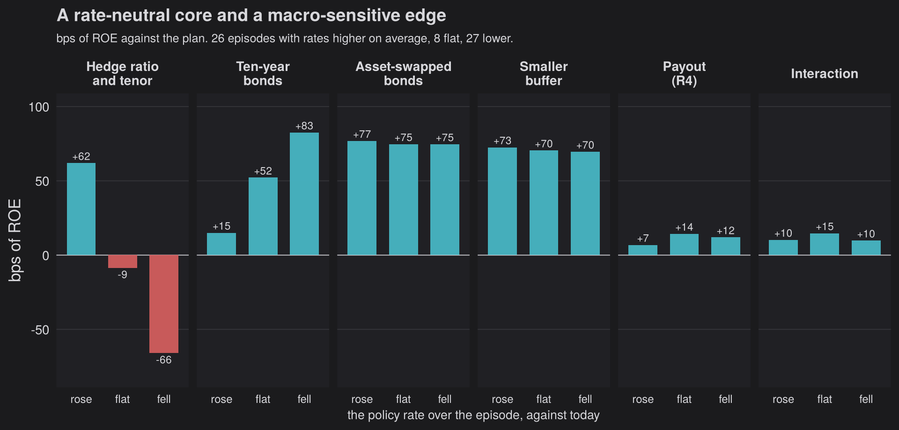

The portfolio has a rate-neutral core and a macro-sensitive edge.

-   **The core is the two spread trades.** The asset swap adds +76 bps and the smaller buffer +71 bps, and both add the same whether rates rise or fall, growth is strong or weak, or the episode holds a contraction. One collects the fiscal premium, the other the gap between wholesale funding and bills, and neither depends on the policy path. Together they are 69% of the gain, and they use no EVE budget.
-   **The edge is where the duration sits.** The plan holds its duration in the receive-fixed hedge. The optimiser moves part of it into government bonds: it cuts the hedge to the rate-neutral ratio and holds ten-year bonds and longer reinvestment instead, at a similar EVE, because a ten-year bond earns the fiscal premium on top of the term premium a swap earns. The two then offset each other across the rate cycle. The smaller hedge gains +62 bps when rates rise and loses 66 bps when they fall; the bonds add +83 bps when rates fall and +15 bps when they rise. The whole portfolio adds +244 bps when rates rise and +183 bps when they fall.
-   **The payout is the one macro rule that survives.** R4 adds +10 bps directly and most of the +11 bps interaction, by paying out more of the other levers' earnings in good times. It adds least where growth is weak, which is the point: it keeps capital where the downturns are.

Why are the other rules not chosen? Under binding limits, a rule earns its place only if its signal predicts the premium it collects better than a fixed setting that uses the same room. R1 and R2 time the rate cycle, which the lab found does not pay. R3 earned the most of any single rule in the lab, but it trades its book: its realised losses in hiking cycles count against the tail limit, and its duration, and so the EVE budget it uses, peaks when the curve is steepest, so within a budget a fixed holding does better. R6 holds less than a fixed 50% while the spread is as tight as today's, and R7 holds more liquidity than a fixed 160% in stress quarters; both cost income under a cap that binds. The rules' value lies in what this engine does not price, R7's liquidity in a run and R6's sizing to spread risk. They belong in the ALCO's playbook as risk triggers rather than return engines.

The result leans on two things, and both are the bank's to set. **The liquidity book carries it:** with the hedge and payout left at the plan, the liquidity book alone adds +146 bps, while with the liquidity book left in bills, the hedge and payout together add only +10 bps. **And it rests on the cap and the spread appetite:** the optimiser takes the spread trades to whatever limits it is given, because the engine prices neither the asset swap's spread risk beyond the modelled spread nor the liquidity a smaller buffer gives up. With the asset swap at most a quarter of HQLA and the LCR no lower than 170%, the gain is +158 bps; with the liquidity book capped at 70% or 50% of earning HQLA, it is +173 bps or +138 bps. Those limits belong to the bank's credit-spread risk appetite and its own liquidity stress test, and the variants say what each is worth.

Out of sample, the portfolio chosen on the first 25 episodes (starting 2008Q2 to 2014Q2, which hold the 2008--09 cuts) is the full sample's, and on the last 25 it adds +217 bps against a best possible +220 bps. Chosen on the last 25 (starting 2017Q2 to 2023Q2, which hold the 2021--23 hiking cycle), the optimiser prefers a 20% hedge reinvested at ten years with 25% of HQLA in ten-year bonds, less receive-fixed and more bonds. On the first 25 that choice adds +165 bps against a best possible +203 bps. The rate-neutral core transfers between periods. How much duration to hold, and where, depends on which rate cycles the sample happens to contain, which is why that budget should be set explicitly rather than read off history.

## The lever that was missing

Before writing this up I went back through the optimiser's levers looking for an approach it had missed, something that would squeeze more NII or ROE out of the same strategy. Most candidates failed, and for reasons worth recording:

-   **Issuing Additional Tier 1 or Tier 2 capital** would cheapen the total capital stack, but what binds in the downside is the CET1 floor, which neither instrument counts towards.
-   **Pricing deposits harder** is already in the lever list as an upper bound (+36 bps), and without a measured volume response it cannot be sized honestly.
-   **Terming out wholesale funding** for the NSFR needs a term premium on bank paper that public data do not publish.
-   **Repo-ing the HQLA bonds** to release cash is economically the same trade as shrinking the buffer, which the optimiser already has.
-   **Redeploying HQLA into lending** is ruled out at the margin by the positioning section: the plan is optimal under the baseline, and the static case for more lending is a franchise question.
-   **Holding the bonds at amortised cost** instead of fair value changes reported CET1 volatility, not the economics, and HQLA count at market value in the LCR either way.
-   **Options on rates** need a ZAR volatility surface that is not public.
-   **A one-off capital distribution** competes with R4 for the same capital room, and inside the budget R4 uses it better.

One candidate survived, and it is the one resource every lever so far leaves alone: **the size of the balance sheet itself.** Every lever above rearranges the balance sheet NGFB already has. A rand of bills becomes a rand of bonds, a rand of bills repays a rand of wholesale funding, a rand of profit is paid out or kept. But a bank can also buy more government bonds than its liquidity buffer needs, asset-swap them exactly as above, and fund them in repo against the bonds themselves. That is how South African banks hold much of their sovereign book, and it was missing from the optimiser.

Funded in repo rather than by displacing bills, each rand of this carry book earns the bond--swap spread plus the floating leg, less the repo rate and the spread NGFB pays over it:

$$\text{carry}_t \;=\; bs \;+\; f_t \;-\; \big(r^{\text{repo}}_t + s^{\text{repo}}\big) ,$$

with $s^{\text{repo}}$ = 10 bp, the spread NGFB already pays on its repo funding. At the jump-off that is 0.58 pp a year, about 0.23 pp less than the same bond earns inside the buffer, because the bills it would replace there yield below the policy rate while repo costs above it. What makes it interesting is what it does *not* use. It needs no HQLA, because the bonds are encumbered in the repo and secured funding against Level 1 collateral carries no LCR outflow. It needs no EVE budget, because the swap removes the rate risk. It needs almost no risk-weighted assets, because rand claims on the sovereign carry a zero risk weight, which leaves only the counterparty risk on the repo and the swap. It adds 5% of its size to required stable funding and all of it to the leverage exposure.

So it needs limits the optimiser did not have, and three are added. The **leverage ratio**, CET1 over on-balance-sheet assets (a conservative stand-in for Tier 1 over the full exposure measure), must stay at or above 5%. South Africa's minimum is 4%, and from July 2025 a systemically important bank holds a further leverage buffer of half its higher-loss-absorbency requirement (Prudential Authority 2025a). The **CET1 floor** must now hold in the named scenarios as well as in the replayed histories. And the book's **credit-spread risk** is measured: what a 100 bp widening of the bond--swap spread would take off the bond books, after tax, as a share of CET1,

$$\text{spread risk} \;=\; \frac{100 \times \text{spread PV01} \times (1-\tau)}{\text{CET1}} .$$

The carry book is then added to the central portfolio in steps of R25bn, with every other lever left where it was.

| Carry book | ROE against the plan | against the central portfolio | 100 bp spread widening (% of CET1) | CET1 trough, histories | CET1 trough, downside | Leverage ratio, lowest | Every limit met |
|---------|---------|---------|---------|---------|---------|---------|---------|
| none | +213 bps | +0 bps | 7.6% | 11.73% | 11.60% | 5.95% | yes |
| R25bn | +223 bps | +10 bps | 8.5% | 11.70% | 11.56% | 5.85% | yes |
| R50bn | +233 bps | +20 bps | 9.4% | 11.66% | 11.52% | 5.76% | yes |
| R75bn | +242 bps | +29 bps | 10.4% | 11.63% | 11.47% | 5.67% | **no** |
| R100bn | +252 bps | +39 bps | 11.3% | 11.59% | 11.43% | 5.58% | **no** |

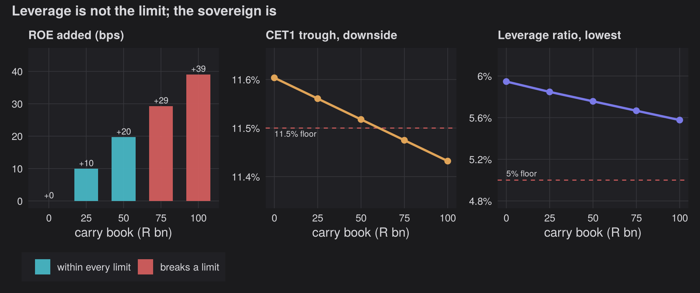

Each R25bn of carry book adds about 10 bps of ROE (R0.4bn of NII over three years) and 0.9 points of CET1 to the loss from a 100 bp spread widening. It earns that in every macro regime alike, as the asset swap inside the buffer does: the R100bn book adds +38 bps when rates rise, +37 bps when they fall and +38 bps in episodes with a contraction.

None of the limits the optimiser already had stops it. Even with R100bn added, the leverage ratio is 5.6% at its lowest, and across the replayed histories the CET1 floor would not bind until well beyond the largest book tested. The leverage ratio, which looked like the obvious guard at the gate, turns out to be asleep in the guardhouse. History does hold spread widenings as large as the downside's (0.64 pp at the worst, in the episode that replays 2020, against 0.54 pp in the downside), but never at the same time as a deep contraction *and* rising rates. 2020's widening came with 300 bps of cuts, and 2015--16's with hikes but no deep recession, so in history the carry book's loss never landed on capital already thinned by credit losses and a hedge losing money. The stagflationary downside combines all three, and that is what binds: at R75bn its CET1 trough falls to 11.47%, below the floor. The largest book that keeps every limit in every history and every scenario is R50bn. It lifts the central portfolio by +20 bps to +233 bps against the plan, and raises the loss from a 100 bp spread widening from 7.6% to 9.4% of CET1.

The lesson for the risk budget is worth more than the twenty basis points. A budget set only on EVE, on capital in replayed history and on liquidity barely sees a position whose risk is the sovereign spread. The carry book walked straight through all three, and only a scenario built around a fiscal shock stopped it. So it needs a limit of its own, a credit-spread budget in the banking book (CSRBB), and every point of CET1 put into that budget buys about 11 bps of ROE. Whether that is a good price is a question about the sovereign, not about NGFB. The carry *is* the fiscal premium, and a bank that earns more of it is more exposed to exactly the event the premium pays for. Selling insurance is a lovely business until the claim comes in. In a banking system whose fortunes are already tied tightly to the sovereign's (Hesse and Miyajima 2022), that is not an abstract point.

## What didn't work and some health warnings

The standing rule holds. Everything that was tried and failed is declared, because the failure is informative and because a reader who tries the obvious thing should know where it leads.

Four of the failures are told in full above and need only a line here: **maximising the engine's ROE directly** (324 bps of make-believe, replaced by reverse optimisation), **a swap curve inside the government curve** (265 bps of ROE that was never there, replaced by actual fixings), **the SARB's broken all-share series** (replaced by the OECD index, with a tripwire in the build), and **macro rules that time the rate cycle or credit, or stack without a budget** (replaced by the risk budget). The rest are new.

**Drawing every product share from six banks.** That needs a covariance with 66 parameters from six observations, and produced implausible balance sheets. Drawing five business-line dimensions and splitting within lines fixed it.

**Carving NGFB out of the existing banks.** Taking NGFB's book from the reported banks distorted every peer group's history and share dynamics. Adding NGFB to the industry leaves the data untouched.

**The SARB coincident indicator as the activity measure for regimes.** It ran negative through 2025--26 while GDP grew, labelling an expansion a contraction. Regimes now use real GDP alone.

**Naive LCR run-off factors.** Fixed run-offs by deposit line, generous inflows and no encumbrance put NGFB's LCR at 1,090%, a number that would make a treasurer smug and a regulator suspicious. Depositor-weighted Basel factors, calibrated to the published sector ratio, bring it to 190%.

**An outlier left in the calibration window.** One quarter of BA120 call-deposit cost at 10.5% pushed the solved wholesale spread to −0.26 pp over JIBAR, a funding spread nobody has ever been offered. Replacing it with the window median gives +1.17 pp.

**Monthly interest annualised by twelve.** A month's interest times twelve reads every February, with its 28 days of interest, as a 0.31 pp fall in savings-deposit costs, so every year the models celebrated a February rate cut that nobody had announced. The month's own day count removes the artefact.

And the health warnings, of which there are more than usual.

**Public data only.** Prices, losses and costs are the sector's, and NGFB differs from the sector only through its mix and its hedge. The relative loss multipliers by product are an external assumption normalised to the sector's loss ratio, because no return publishes losses by product. A real bank would replace the industry pricing with its own and the multipliers with its own loss history.

**The level of ROE rests on a few inputs.** The swap rates moved the baseline by 265 bps, and the level of credit losses is where the industry models carry the most model risk. The differences between scenarios, and the positioning, are much less sensitive to either.

**The swap curve does not price each scenario's path.** Swap rates are the benchmark plus constant term spreads, so receive-fixed swaps look slightly cheap in scenarios with cuts and dear in scenarios with hikes. With a curve that prices half of the coming path the conclusions stand: R1 still adds nothing (+4 bps), and the gains from the tenor rule and a higher static ratio barely move, because they come from the term premium and today's swap rate, not from timing.

**History is one history.** The 61 overlapping windows hold about five or six independent three-year periods, one global financial crisis and one pandemic. The tail limit is the 5th percentile of those, which is the fourth-worst episode.

**The optimiser takes unpriced risks to their limits.** The asset swap's spread risk enters only through the modelled spread, and a smaller buffer's cost only through the LCR and NSFR, neither of which stresses run-offs or funding spreads. So both go to whatever caps they are given, and the caps are judgement.

**The carry book's funding is assumed to roll.** Repo is priced at NGFB's calibrated spread over the policy rate in every quarter. In a market dislocation like March 2020 repo haircuts and rates jump, and the book's real backstop is the SARB's lending facilities at a penalty rate. The engine prices neither.

**The bond--swap spread rests on three years of swap data,** a period in which the spread mostly compressed. A sovereign shock could move it more than a quarter of the long bond's move, which is why the spread risk is also measured at a flat 100 bp.

**Execution costs size the positioning moves.** Their direction is robust; their size scales with an assumption about how expensive it is to move a franchise inside a year.

**No second-round effects.** The scenarios are exogenous: NGFB's actions do not move prices or the macro path, and the sector does not respond to NGFB.

**ZARONIA is modelled at the fallback, not contract by contract.** In practice loans and notes follow their own fallback clauses and re-papering, and the quarter in which each contract switches is not known from public data.

**NGFB's hedge is not re-optimised for the refined deposit models.** The rate-neutral 37% is a finding about the canonical bank, not a recommendation for a real one.

------------------------------------------------------------------------

## What ALCO does on Monday

1.  **Fund the two spread trades first.** Asset-swapped government bonds and a smaller buffer add about 147 bps of ROE in every macro regime, with no rate view and no EVE cost. Size them against a credit-spread limit and the bank's own liquidity stress test, not against the LCR.
2.  **Hold duration in bonds, not only in swaps.** At the same EVE, a government bond earns the fiscal premium on top of the term premium a swap earns. Keep the structural hedge near its rate-neutral ratio and let the bond book and the reinvestment tenor carry the duration the budget allows.
3.  **Make the payout state-contingent.** R4 is the one macro rule that survives the risk budget.
4.  **Use the other macro rules as risk triggers, not return engines.** The slope, the bond--swap spread and the stress signals say when the premia are large and when liquidity is worth more. Under binding limits they do not beat fixed settings on return.
5.  **Set the budgets explicitly, and price them.** At 5% of CET1 the portfolio adds +213 bps; the frontier says what each further point of EVE budget is worth, and the carry book says what a point of credit-spread budget is worth.
6.  **Position ahead of a scenario in proportion to conviction, and read the regret matrix before the gain.** The credit leg of a downside positioning is robust to the SARB's response. The rate leg is a bet on it.
7.  **Push where the market grows and NGFB does not.** Cards, corporate lending and vehicle finance in easing cycles, with their own deposits behind them; tighter card underwriting when GDP turns. Then judge the result against macro par, not against last year.

## The end of this one

The deposit series ended by pricing something it could not estimate. This one ends somewhere similar. The macro view matters enormously to what NGFB earns: its plan swings from 10.6% to 16.8% across sixty-one histories, and two macro numbers explain 95% of that spread. But mattering is not the same as being tradeable. Keying the hedge to the level of rates earned nothing. Positioning ahead of a downside recovered 8% of the damage and cost more than twice as much if the upside arrived instead. The one rule that survived a risk budget was a payout that pays more when the economy grows, which is less a forecast than good manners.

What did pay was dull. Collecting the fiscal premium without its duration, and not paying wholesale rates to hold bills nobody needs, added about a point and a half of ROE whatever the history, and the risk budget turned a pile of good ideas into a portfolio that beat the plan in every one of the 61 histories. The missing lever added another 20 bps, and a lesson worth more than the basis points: a risk budget that only sees rates, capital and liquidity will let a sovereign-spread position walk straight through it.

This ran on a bank that does not exist, with industry models I have deliberately not shown you, so I cannot tell you what it would do to yours. What I can say is that the shape of the answer is unusually robust. The spread trades paid in every history and every scenario. The rate bets did not. A treasury that sets its budgets explicitly, funds the premia that need no view, and keeps its rate views for the occasions it genuinely has one, should not need a crystal ball to earn its cost of equity more often than once in sixty-one tries.

*No refunds, as the man selling coat hangers at the robot will tell you: none of this is advice, and your own bank's risk budget should be set by people who can see its books.*

------------------------------------------------------------------------

## References

Aitchison, John. 1986. *The Statistical Analysis of Compositional Data*. Monographs on Statistics and Applied Probability. London: Chapman and Hall.

Basel Committee on Banking Supervision. 2013. "Basel III: The Liquidity Coverage Ratio and Liquidity Risk Monitoring Tools." Basel: Bank for International Settlements. <https://www.bis.org/publ/bcbs238.htm>.

---------. 2014. "Basel III: The Net Stable Funding Ratio." Basel: Bank for International Settlements. <https://www.bis.org/bcbs/publ/d295.htm>.

---------. 2016. "Interest Rate Risk in the Banking Book." Standards d368. Basel: Bank for International Settlements. <https://www.bis.org/bcbs/publ/d368.htm>.

Black, Fischer, and Robert Litterman. 1992. "Global Portfolio Optimization." *Financial Analysts Journal* 48 (5): 28--43. <https://doi.org/10.2469/faj.v48.n5.28>.

Campbell, John Y., and Robert J. Shiller. 1991. "Yield Spreads and Interest Rate Movements: A Bird's Eye View." *The Review of Economic Studies* 58 (3): 495--514. <https://doi.org/10.2307/2298008>.

CME Group. 2026. "ZAR Risk-Free Rate Transition to ZARONIA: Conversion, Legacy JIBAR Replacement, Fallback Spreads and Dress Rehearsal Guide." CME Group. <https://www.cmegroup.com/articles/2026/zar-risk-free-rate-transition-to-zaronia-conversion-replacement-fallback-spreads-and-dress-rehearsal.html>.

DerSimonian, Rebecca, and Nan Laird. 1986. "Meta-Analysis in Clinical Trials." *Controlled Clinical Trials* 7 (3): 177--88. <https://doi.org/10.1016/0197-2456(86)90046-2>.

Drechsler, Itamar, Alexi Savov, and Philipp Schnabl. 2021. "Banking on Deposits: Maturity Transformation Without Interest Rate Risk." *The Journal of Finance* 76 (3): 1091--1143. <https://doi.org/10.1111/jofi.13013>.

Fama, Eugene F., and Robert R. Bliss. 1987. "The Information in Long-Maturity Forward Rates." *American Economic Review* 77 (4): 680--92.

Hesse, Heiko, and Ken Miyajima. 2022. "South Africa: The Financial Sector--Sovereign Nexus." IMF Working Paper WP/22/51. Washington, DC: International Monetary Fund. <https://doi.org/10.5089/9798400204418.001>.

IFRS Foundation. 2014. "IFRS 9 Financial Instruments." International Accounting Standards Board. <https://www.ifrs.org/issued-standards/list-of-standards/ifrs-9-financial-instruments/>.

Organisation for Economic Co-operation and Development. 2026. "Financial Market: Share Prices for South Africa (SPASTT01ZAM661N)." Retrieved from FRED, Federal Reserve Bank of St. Louis. <https://fred.stlouisfed.org/series/SPASTT01ZAM661N>.

Prudential Authority. 2025a. "Directive D3/2025: Matters Relating to Leverage Buffer Requirements." South African Reserve Bank, Prudential Authority. <https://www.resbank.co.za/content/dam/sarb/publications/prudential-authority/pa-deposit-takers/banks-directives/2025/D3-2025%20-%20Matters%20relating%20to%20Leverage%20Buffer%20requirements.pdf>.

---------. 2025b. "Selected South African Banking Sector Trends." South African Reserve Bank, Prudential Authority, monthly. <https://www.resbank.co.za/en/home/publications/publication-detail-pages/prudential-authority/pa-statistics-selected-trends---monthly/2025/Selected-SA-Banking-Sector-Trends-2025-Monthly>.

rbond.co.za. 2026. "South African Interest-Rate Data: JIBAR Swap Fixings, ZARONIA, JIBAR and Government Bond Yields." Daily data, licensed CC BY 4.0. <https://rbond.co.za>.

South African Reserve Bank. 2023a. "Market Conventions for ZARONIA-Based Derivatives." Pretoria: Market Practitioners Group, Derivatives Workstream. [https://www.resbank.co.za/content/dam/sarb/publications/media-releases/2023/zaronia-based-derivatives/Market\\20conventions\\20for\\20ZARONIA-based\\20derivatives.pdf](https://www.resbank.co.za/content/dam/sarb/publications/media-releases/2023/zaronia-based-derivatives/Market\%20conventions\%20for\%20ZARONIA-based\%20derivatives.pdf).

---------. 2023b. "Financial Stability Review, Second Edition 2023." Pretoria: South African Reserve Bank. <https://www.resbank.co.za/en/home/publications/reviews/financial-stability-review>.

---------. 2025. "BA 900: Institutional and Maturity Breakdown of Liabilities and Assets (Monthly Economic Returns of Banks)." Prudential Authority, selected SA banks data, with the BA 100, BA 120, BA 200 and BA 700 sector returns. <https://www.resbank.co.za/en/home/what-we-do/statistics>.

South African Reserve Bank, Market Practitioners Group. 2025. "JIBAR Cessation." Media release. <https://www.resbank.co.za/content/dam/sarb/publications/media-releases/2025/mpg-/jibar-cessation.pdf>.
