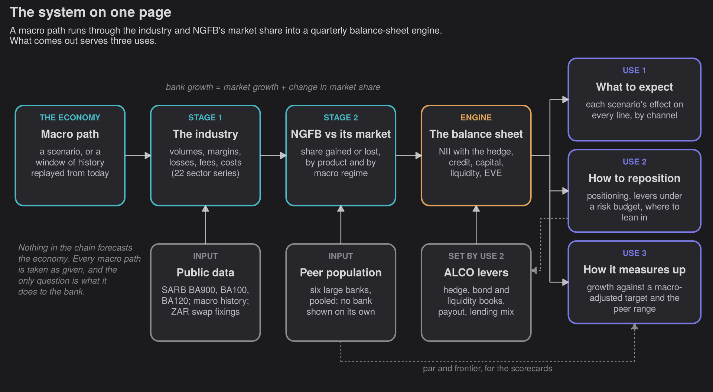
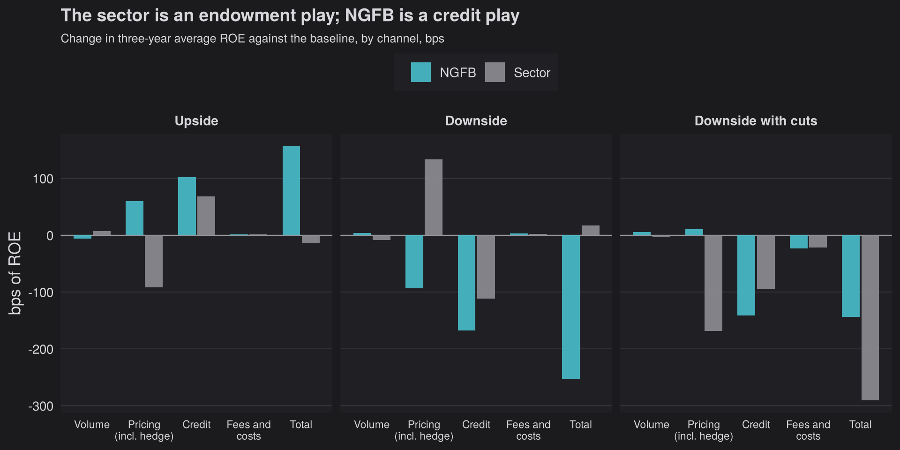
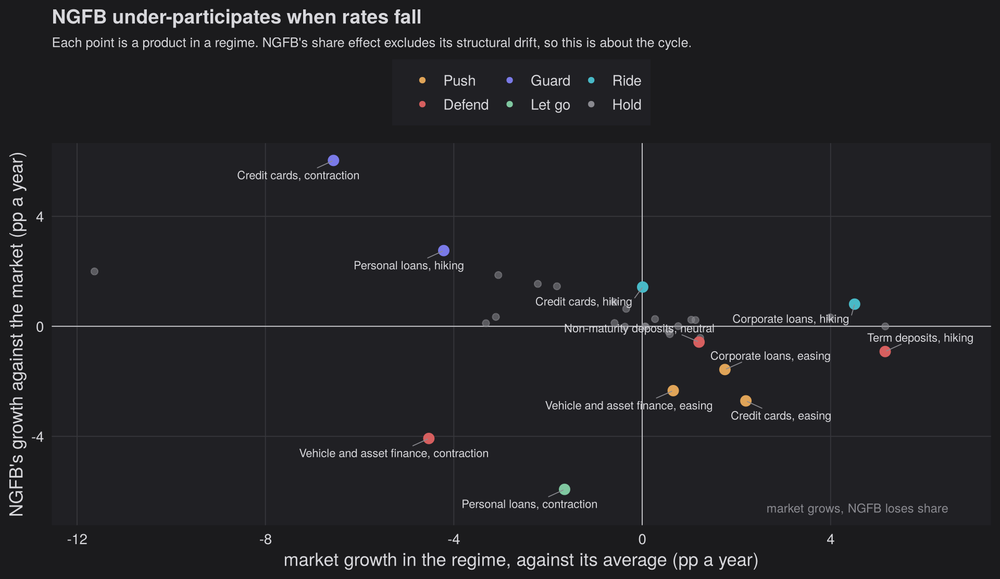
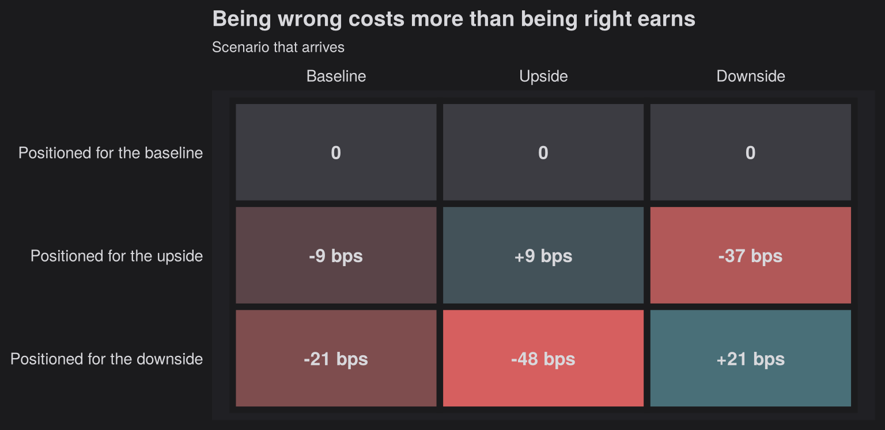
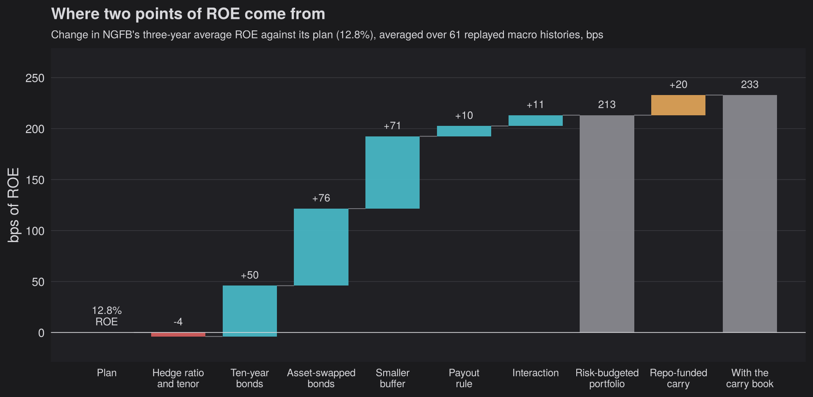
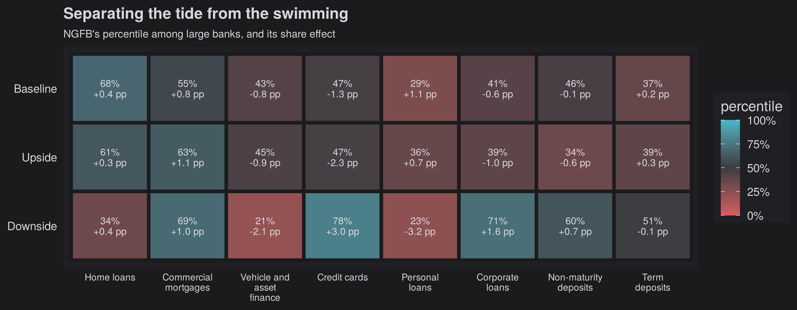

  ⚠️
  

    
Synthetic bank notice

    
No Gut Feelings Bank does not exist. Its deposit franchise is the posterior-predictive draw the earlier posts used, and its asset mix is a draw from the population of the six largest South African banks, with every bank-specific effect integrated out. Real banks appear only pooled into peer groups of at least four. Nothing here ranks, names, or reverse-engineers any individual institution. Nothing here is financial advice.

  

{{< summary   trader="Most banks keep their macro model for the stress test. This post points No Gut Feelings Bank's at the whole balance sheet. A macro path runs through the industry and NGFB's market share into a quarterly engine, and three things come out. What to expect: the industry is an endowment play that earns more when rates rise, while NGFB, with an unsecured-heavy book and a large receive-fixed hedge, is a credit play whose rate exposure turns on how the SARB answers a downturn. How to reposition: tilting the balance sheet ahead of a stagflationary downside recovers 21 bps of a 253 bp hit and costs 48 bps if the upside comes instead, so the money is in levers that need no view. Chosen together under a risk budget, they lift NGFB's average ROE from 12.8% to 15.0% across 61 replayed histories and beat the plan in every one. Commercially, NGFB under-participates when rates fall. How it measures up: each book's growth is judged against its market's growth plus what a typical large bank achieves in the same phase of the cycle, which separates the tide from the swimming."   loremaster="Identity g_bank = g_sector + Δlog s. Stage 1: sign-restricted ARDL industry models (details withheld) map macro paths to 22 BA900/BA120 sector series. Stage 2: 400Δlog s on contraction/hiking/easing dummies and the sector cycle, by peer group (k ≥ 4) and for six large banks pooled with DerSimonian–Laird random effects; NGFB's parameters are a truncated posterior-predictive draw. Quarterly engine: line-level NII with a laddered receive-fixed hedge at actual ZAR swap fixings, sector credit-loss ratio with relative multipliers, CET1 with the FVOCI reserve, LCR/NSFR proxies calibrated to PA aggregates. Positioning: Black–Litterman-style reverse optimisation (c = G_baseline), x* = (G − c)/2κ. Risk budget: 25,200 lever combinations scored over 61 overlapping 12-quarter histories under 5th-percentile ROE, CET1, LCR, NSFR and ΔEVE limits: +213 bps, p5 +198 bps, 61/61 wins. Share strategy: market growth by regime against NGFB's share effect, with marginal headroom per rand. Scorecards: target = realised market growth + population par by regime + ambition, with percentiles from the population's predictive distribution.">}}

The deposit series ([one](./posts/deposit-beta-1-4/), [two](./posts/deposit-duration-2-4/), [three](./posts/hedge-optim-3-4/), [four](./posts/pricing-unknown-4-4/)) ended with No Gut Feelings Bank's funding understood about as well as public data allow. This post gives NGFB the rest of a balance sheet and ties it to the economy.

Every quarter an ALCO gets a macro pack (the house view, an upside, a downside) and asks the same three questions of it. How exposed are we? What does each scenario do to our returns? What should we do before it arrives? There is a fourth that rarely makes the pack: what should we do when we do not know which scenario is coming? Which is always.

Most banks own the machinery to answer them, and point it at something else. Macro models in a bank usually live with the stress-testing team: they turn the regulator's adverse scenario into a capital ratio for the internal capital adequacy assessment (ICAAP) and supply the forward-looking scenarios behind the IFRS 9 credit provisions. Once a year they prove that the bank survives something unpleasant, and then they go back in the cabinet with the good crockery. That undersells them. A model that can say what a recession does to capital can say what any macro path does to every line of the balance sheet, which makes it useful every quarter, for three jobs a stress test never asks of it:

-   **What to expect.** What each economic outcome does to every book, margin and ratio, and so what the card book, the home loans or the deposit franchise can reasonably deliver in each scenario.
-   **How to reposition.** Which balance-sheet and commercial decisions depend on a macro view and which do not, and what each is worth either way.
-   **How the bank measures up.** A business that grew its book 8% while its market grew 12% lost ground, however well 8% presents at bonus time. Take the market out of each segment's growth and what is left is what management actually did, and how that compares with competitors.

This post builds the machinery for NGFB from public SARB data and puts it to all three jobs. The scenarios are illustrative and get a single table. The machinery, and what it says, get the rest.

## The system on one page

Read it left to right. A macro path, one of the ALCO's scenarios or a three-year window of South African history replayed from today, goes first to the **industry**. Stage 1 maps it to the growth of every loan and deposit book in the banking sector, lending spreads, deposit costs, the credit-loss ratio, fees and operating costs: 22 series in all, built on the SARB's BA900 and BA100/BA120 returns. The workhorse is a sign-restricted ARDL model, and its specification and estimates are staying in the drawer, like any koeksister recipe worth having. Here it is a black box with a simple contract: hand it a macro path, and it hands back the industry's volumes, margins and losses along that path.

The bank is tied to the industry rather than straight to the economy, because a single bank's history is short and full of things that are not the economy: an acquisition, a new strategy, a provisioning overlay. Regress that on GDP and the elasticities come out unstable and, more often than is comfortable, the wrong sign. It is like judging a flyhalf's form by the rand--dollar exchange rate. There will be a correlation, and you will regret acting on it. Instead the bank is tied to its market by an identity. For any product $p$,

$$g^{\text{bank}}_{p,t} \;=\; g^{\text{sector}}_{p,t} \;+\; \Delta \log s_{p,t}$$

says that the bank's growth in quarter $t$ is the market's growth plus the change in its market share $s$, with growth measured in logs so that the pieces add. The first piece is the tide, and Stage 1 explains it. The second is the swimming, and **Stage 2** models it, product by product, as

$$400\,\Delta \log s_t \;=\; a \;+\; \delta_{\text{c}}\,C_t \;+\; \delta_{\text{h}}\,H_t \;+\; \delta_{\text{e}}\,E_t \;+\; \kappa\,\big(g^{\text{sector}}_t - \bar g\big) \;+\; e_t .$$

The 400 turns a quarter's change in log share into percentage points a year. $a$ is the structural drift, how fast a bank gains or loses share in an ordinary quarter. $C_t$, $H_t$ and $E_t$ switch on in contraction, hiking and easing quarters, so each $\delta$ is the extra drift in that phase of the cycle. $\kappa$ asks whether the bank grows faster than the market when the market booms ($g^{\text{sector}}_t$ above its average $\bar g$), and $e_t$ is everything else.

The equation is estimated for peer groups of at least four banks and for each of the six large banks, and the six are pooled into a population with a random-effects estimator that separates genuine differences between banks from estimation noise (DerSimonian and Laird 1986). That population does two jobs. NGFB is a draw from it: a typical large bank rather than a copy of any one, and on the unsecured-heavy side as it happens, with 11.4% of its assets in unsecured retail lending against the population centre's 5.2%. And it supplies the yardstick for judging a bank against its competitors, of which more below. No real bank's estimate is ever shown on its own.

The **engine** then does what a bank's planning model does, quarter by quarter and line by line. Each book grows with its market and NGFB's share dynamics, wholesale funding balances the books, and every line earns or costs the industry's projected rates. The structural hedge gets its own term, because most of the rate risk lives there: each receive-fixed tranche $i$ earns its fixed rate $F_i$ and pays the floating benchmark $f_t$ on its notional $N_i$, so the hedge adds $H_t = \sum_i N_i\,(F_i - f_t)/4$ to net interest income each quarter. Below that come credit losses, fees, costs, tax and the payout, and out come ROE, CET1, the LCR and NSFR, and the sensitivity of the economic value of equity (EVE) to rates. Every ROE in this post is the average over the twelve quarters from 2026Q3 to 2029Q2.

The levers the ALCO sets (the hedge, the bond and liquidity books, the payout and the lending mix) go into the engine, and choosing them is the second of the three uses. Nothing in the chain forecasts the economy. Every macro path is taken as given, which is deliberate: an ALCO will argue about which scenario is coming whatever any model says, and the model's job is to make sure everyone is arguing about the same consequences.

## What to expect: from the economy to the balance sheet

The scenarios are illustrative, so they get one table. The downside is stagflationary on purpose, built the way the SARB built the adverse scenario of its 2023 common stress test (South African Reserve Bank 2023), and a variant runs the same contraction with cuts instead of hikes.

| Scenario | What happens | NGFB ROE | against the baseline | Sector ROE |
|---------------|---------------|---------------|---------------|---------------|
| **Baseline** | the SARB's guidance: repo at 7.25%, easing to 6.25%; growth about 1.6% | 13.2% | -- | 15.7% |
| **Upside** | faster disinflation and a growth dividend; 100 bps more cuts | 14.8% | +157 bps | 15.6% |
| **Downside** | stagflation: a rand sell-off, 150 bps of hikes, a two-year contraction | 10.7% | -253 bps | 15.9% |
| **Downside with cuts** | the same contraction, with 150 bps of cuts | 11.8% | -144 bps | 12.8% |

To see where each difference comes from, the engine swaps one block of inputs at a time from the baseline into the scenario: volumes, pricing (rates, yields and deposit costs, and with them the hedge), credit losses, and fees and costs. Whatever is left when all four are swapped together is the interaction, so the bars always add up. The sector is run through the same engine without a hedge.

Three things stand out, and none of them shows up in a capital ratio.

-   **The industry is an endowment play.** Deposits and equity are cheap funding lent out at market rates, so when rates rise the sector earns more on them (Drechsler, Savov, and Schnabl 2021). Without a hedge, the downside's higher repo path adds +133 bps to the sector's ROE through pricing, more than its credit losses take away (-111 bps).
-   **NGFB is a credit play.** Its unsecured-heavy book makes credit its largest channel (-168 bps in the downside), and its receive-fixed hedge more than offsets its endowment, so the higher rates *cost* it 93 bps through pricing. Over three years the downside takes R9.6bn off NGFB's net income while the unhedged sector's ROE rises.
-   **The SARB decides the sign.** With the same contraction and cuts instead of hikes, the hedge earns NGFB +10 bps through pricing and the total loss shrinks to 144 bps, a little over half the stagflationary one. A structural hedge protects against the downturns of 2009 and 2020. It does not protect against a downturn that arrives with hikes.

The same runs say what each part of the bank can reasonably be expected to deliver. As a conversion rate, one basis point of ROE is worth about R12m of net income a year. A repo path 100 bps higher costs hedged NGFB 21 bps of ROE, where unhedged it would add 130 bps: the hedge was sized for deposits that reprice more slowly than the industry models find, which makes it a position as much as a hedge. One point less GDP growth for three years costs 67 bps, almost all of it through credit losses, so growth is NGFB's largest exposure by a distance. Book by book, the engine gives every product's growth, margin and losses in every scenario, which is what a business unit's plan should be built on, and what its performance is judged against further down.

## How to reposition

Repositioning comes in three kinds, and they need different amounts of conviction: commercial (where to grow against the market), tactical (ahead of a scenario) and structural (the treasury levers, which turn out to need no view at all).

### Where to lean in against the market

The cheapest growth a bank forgoes is in markets that are growing while it is not. Two numbers place NGFB in each product and phase of the cycle. The first is how fast the market grows in that regime, from the industry's history, which no bank controls. The second is NGFB's *share effect*, how much faster or slower than the market its book grows, from Stage 2.

The rules that turn a cell into an action are economic, not statistical. **Push** where NGFB loses share while its market grows at or above its average: that is under-participation. **Defend** where it loses secured or deposit share to competitors taking good business. **Guard** where it gains unsecured share while the market weakens. **Let go** where it cedes unsecured share in a contraction, which is risk appetite doing its job. **Ride** gains in a growing market.

The gap is in easing cycles. When rates fall, the card market grows 9.1% a year against an average of 6.9%, yet NGFB's card book grows 2.7 points a year more slowly than the market, and the Challengers take 100% of what it gives up. Corporate loans and vehicle and asset finance follow the same pattern. Whether to push is a question of marginal economics. Per rand of new lending, the rate earned, less the funds-transfer price, the cost of the liquidity that funding needs, the expected credit loss and the cost of the capital it ties up, leaves the *headroom* that origination and servicing can cost before growth destroys value. Cards clear it even on wholesale funding (+1.7 pp a year); corporate lending and vehicle finance clear it comfortably only when they bring their own deposits.

The guard case is cards in a contraction, where NGFB gains share (+6.0 pp a year) while the market all but stops. In a downturn the customer walking in is often the one other banks have just declined, so the action is to tighten underwriting on new card business when GDP turns, not to celebrate the share.

### Ahead of a scenario

When the ALCO has a view, the balance sheet can lean towards it: shift HQLA into a lending book, swap wholesale funding for deposits, or change the hedge. The naive way to choose, maximising the engine's ROE, grows every loan book out of HQLA and claims 324 bps of ROE, the kind of number that wins a consultant a second engagement. The engine prices a new rand of lending at the book's average yield, loss rate and cost, so every risk asset looks better than a Treasury bill.

The fix is to assume the current balance sheet is right for the baseline, which is what a balance sheet built for the bank's central plan ought to be. If $G_s$ is how much one unit of a move adds to ROE in scenario $s$, that reveals an implied marginal cost for every move, $c = G_{\text{baseline}}$: whatever a move would add under the baseline must be offset by costs the engine cannot see. It is the trick Black and Litterman used to back implied returns out of market weights (Black and Litterman 1992). Positioning then trades only on how a scenario *changes* each move's value, and with an execution cost that rises with the square of the move, $\kappa x^2$, the best move has a closed form:

$$x^{*} \;=\; \frac{G_{X} - c}{2\,\kappa} .$$

Move in the direction the scenario shifts the move's value, by an amount proportional to how far it shifts it, and inversely proportional to how expensive the move is to make. Ahead of the downside that means cutting the hedge from 49.6% to 40.3% of non-maturity deposits, because its floating leg reprices up with the hikes, swapping 0.53% of assets of wholesale funding for deposits, and trimming cards and personal loans by 0.46% of assets. It recovers 21 bps of the downside's 253 bps hit, about 8%, because positioning cannot undo a credit cycle inside a year. And it is a bet.

Position for the downside and get the upside, and it costs 48 bps: being wrong costs 2.3 times what being right earns. If the contraction comes with cuts instead of hikes, the hedge move flips sign while the credit leg does not, so the credit side of a downside positioning is robust and the rate side is a bet on the SARB. With no strong view, the probability-weighted answer is close to the plan. The framework's value is in telling the ALCO what to do, and what it costs if it is wrong, as conviction builds. Positioning ahead of a downside is like packing an umbrella for a Highveld afternoon: cheap and sensible, and it will not stop the hail.

### Without a view: the treasury levers under a risk budget

The bigger money needs no view. Replay every three-year window of South African history since 2008 from today's balance sheet, 61 overlapping episodes, and timing the rate cycle earns nothing: a hedge ratio keyed to the level of rates makes -2 bps on average. What pays is collecting premia. Government bonds asset-swapped to floating earn the fiscal premium South African bonds pay over swaps, without the interest-rate risk. Releasing surplus Treasury bills to repay wholesale funding saves the gap between the two, about nine basis points of ROE for every R10bn. Neither depends on where the repo rate goes.

The levers are chosen together, because they draw on the same capital, liquidity and rate risk. An optimiser scores all 25,200 combinations of the hedge ratio and tenor, the bond books, the size of the liquidity buffer and the payout across the histories. It keeps the best combination that leaves the 5th-percentile ROE no worse than the plan's, CET1 at fair value above 11.5%, the LCR and NSFR above their floors, and the change in EVE for a ±200 bp shock no more than 5% of CET1 away from the plan's (Basel Committee on Banking Supervision 2016).

The answer keeps the hedge at the rate-neutral 37% of non-maturity deposits, reinvests maturing swaps at seven years, holds 12.5% of earning HQLA in ten-year bonds and 50% in asset-swapped bonds, releases bills down to an LCR of 160%, and pays out more while the economy grows and capital is ample. NGFB's average ROE across the histories rises from 12.8% to 15.0%, its 5th percentile from 11.1% to 13.1%, and it beats the plan in every one of the 61 histories. The two spread trades are 69% of the gain and pay the same in every macro regime.

One more lever adds +20 bps: the balance sheet's own size. Asset-swapped bonds funded in repo outside the buffer use no HQLA and no rate budget, so they walk straight through limits set only on rates, capital and liquidity, until the stagflationary downside's capital floor stops them at R50bn. It is the closest thing here to a free lunch, and like every free lunch in Sandton, somebody else is paying. Here it is the sovereign, which is why the carry needs a credit-spread limit of its own (Hesse and Miyajima 2022).

## How it measures up against competitors

The identity that split growth into tide and swimming also judges it. A product's growth is the market's growth plus the bank's share effect. The first is the macro environment, which no bank controls. The second is what management controls, and the peer population says what a typical large bank achieves in the same phase of the cycle. So a macro-adjusted target for product $p$ in quarter $t$ is

$$\text{target}_{p,t} \;=\; \underbrace{g^{\text{market}}_{p,t}}_{\text{realised, from the returns}} \;+\; \underbrace{\text{par}_p(\text{regime}_t)}_{\text{peer population}} \;+\; \text{ambition}_p ,$$

and performance is actual growth less the target. The market term is measured after the fact, so nobody is punished for a recession or rewarded for a boom. **Par** is the typical large bank (the population mean), the **frontier** a top-quintile large bank (the 80th percentile of the population's predictive distribution), and a bank's percentile between them says how it compares with its competitors in that phase of the cycle without naming or ranking any of them. Set in advance, the target is scenario-contingent: it says what each business can reasonably be expected to deliver if the scenario arrives. Looked back on, it separates the tide from the swimming. Warren Buffett's version is that you only find out who has been swimming naked when the tide goes out; a macro-adjusted target finds out while the tide is still in.

In the downside most of the slowdown in NGFB's books is the market's. Even so, NGFB is below par in home loans (34th percentile), because a typical large bank gains mortgage share in a contraction as lenders retreat to secured credit, and NGFB gains less. Cards sit near the frontier (78th percentile), which is the guard case above, and a reminder that a high percentile is not automatically good news. In the upside the growth is in cards, corporate lending and vehicle finance, and NGFB is below par in all three. The message for management is to protect share where the growth is, not to bank the tide.

The same yardstick shows who has been swimming fastest at peer-group level. Since 2008 the Challengers have taken share at double-digit rates in credit cards (+14.6 pp a year) and household deposits (+11.8 pp), while the Big Four ceded share slowly but steadily. A business judged only against its own last year would miss both.

## Caveats

-   **Public data only.** Prices, losses and costs are the sector's, and NGFB differs from the sector only through its mix and its hedge. A real bank would put its own pricing, loss history and costs in their place.
-   **The industry models are a black box here.** Everything downstream depends on them, and this post deliberately does not show them.
-   **History is one history.** The 61 overlapping windows hold about five or six independent three-year periods, one global financial crisis and one pandemic.
-   **The optimiser takes unpriced risks to their limits.** The engine does not stress run-offs, funding spreads or fire-sale prices, so the spread trades go as far as the caps they are given, and the caps are judgement.
-   **Execution costs size the positioning.** Their direction is robust; their size rests on an assumption about how expensive it is to move a franchise inside a year.

## What an ALCO can do with this on Monday

1.  **Run every macro pack through the whole balance sheet**, not only the capital ratio, and attribute each scenario's effect by channel, so the committee argues about the same consequences.
2.  **Fund the premia that need no view first.** Asset-swapped government bonds and a right-sized liquidity buffer pay in every macro regime; size them against a credit-spread limit and the bank's own liquidity stress test.
3.  **Position ahead of a scenario in proportion to conviction**, with the cost of being wrong on the same page as the gain.
4.  **Push where the market grows and the bank does not**, with its own funding behind the growth, and guard share won in a downturn.
5.  **Judge each business against a macro-adjusted target and the peer range**, not against last year.

The macro view matters enormously to what NGFB earns, but mattering is not the same as being tradeable. What the machinery does reliably is translate: an economic outcome into every line of the balance sheet, a view into a position and its cost if wrong, and a growth number into a verdict on the swimming. That is a better use of a macro model than one stress test a year.

*No refunds, as the man selling coat hangers at the robot will tell you: none of this is advice, and your own bank's risk budget should be set by people who can see its books.*

------------------------------------------------------------------------

## References

Basel Committee on Banking Supervision. 2016. "Interest Rate Risk in the Banking Book." Standards d368. Basel: Bank for International Settlements. <https://www.bis.org/bcbs/publ/d368.htm>.

Black, Fischer, and Robert Litterman. 1992. "Global Portfolio Optimization." *Financial Analysts Journal* 48 (5): 28--43. <https://doi.org/10.2469/faj.v48.n5.28>.

DerSimonian, Rebecca, and Nan Laird. 1986. "Meta-Analysis in Clinical Trials." *Controlled Clinical Trials* 7 (3): 177--88. <https://doi.org/10.1016/0197-2456(86)90046-2>.

Drechsler, Itamar, Alexi Savov, and Philipp Schnabl. 2021. "Banking on Deposits: Maturity Transformation Without Interest Rate Risk." *The Journal of Finance* 76 (3): 1091--1143. <https://doi.org/10.1111/jofi.13013>.

Hesse, Heiko, and Ken Miyajima. 2022. "South Africa: The Financial Sector--Sovereign Nexus." IMF Working Paper WP/22/51. Washington, DC: International Monetary Fund. <https://doi.org/10.5089/9798400204418.001>.

Prudential Authority. 2025. "Selected South African Banking Sector Trends." South African Reserve Bank, Prudential Authority, monthly. <https://www.resbank.co.za/en/home/publications/publication-detail-pages/prudential-authority/pa-statistics-selected-trends---monthly/2025/Selected-SA-Banking-Sector-Trends-2025-Monthly>.

rbond.co.za. 2026. "South African Interest-Rate Data: JIBAR Swap Fixings, ZARONIA, JIBAR and Government Bond Yields." Daily data, licensed CC BY 4.0. <https://rbond.co.za>.

South African Reserve Bank. 2023. "Financial Stability Review, Second Edition 2023." Pretoria: South African Reserve Bank. <https://www.resbank.co.za/en/home/publications/reviews/financial-stability-review>.

---------. 2025. "BA 900: Institutional and Maturity Breakdown of Liabilities and Assets (Monthly Economic Returns of Banks)." Prudential Authority, selected SA banks data, with the BA 100, BA 120, BA 200 and BA 700 sector returns. <https://www.resbank.co.za/en/home/what-we-do/statistics>.
